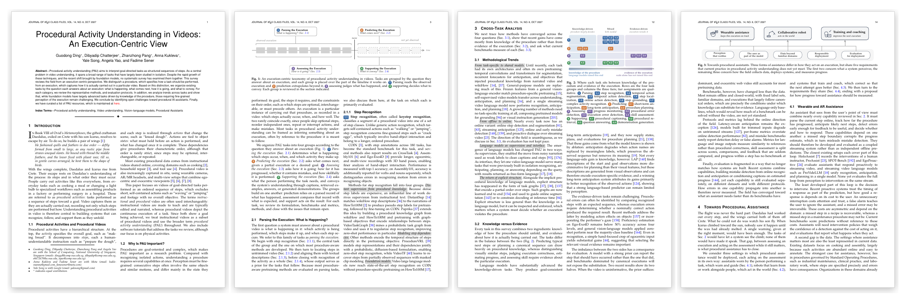
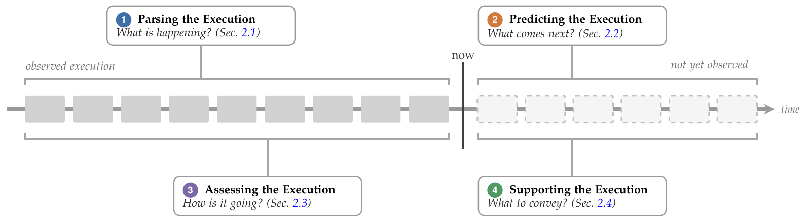
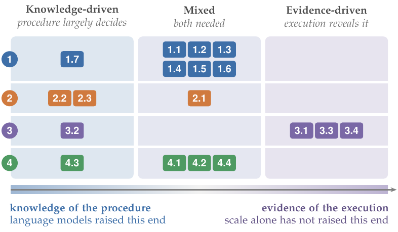
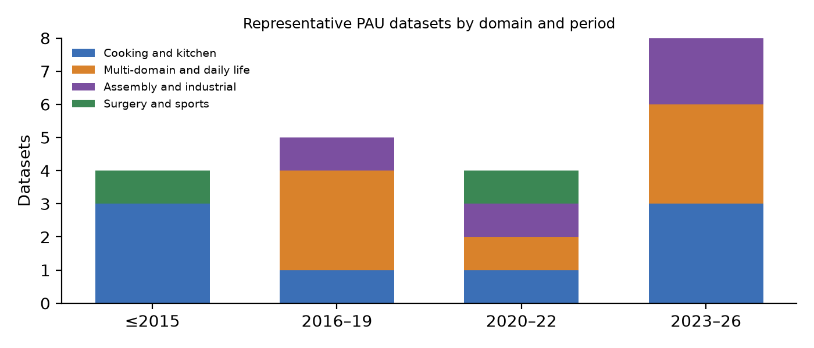
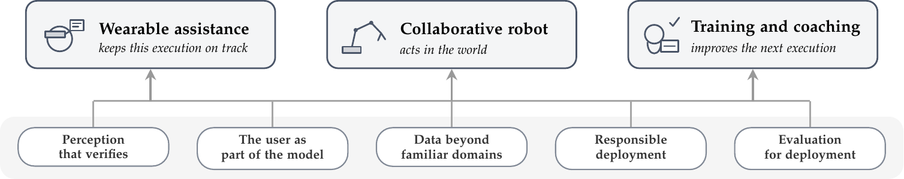

<a id="readme-top"></a>

# Awesome Procedural Activity Understanding

[](https://awesome.re)   [](https://github.com/dinggd/awesome-procedural-activity-understanding/stargazers) [](#) 

**A curated list of papers, datasets, and benchmarks on procedural activity understanding (PAU)**, accompanying our survey *Procedural Activity Understanding in Videos: An Execution-Centric View*. 

<p align="center"><a href="assets/ding2026pau.pdf"></a></p>

<p align="center">📄 <a href="assets/ding2026pau.pdf">Read the survey (PDF)</a></p>


Papers are organized by the survey's taxonomy, and section numbers (§) follow the paper.

🟢 = covered in the survey &nbsp;·&nbsp; 🆕 = added after the survey

## News

- **2026.10.15**: 📝 Survey submitted to IEEE TPAMI. A preprint will follow once TechRxiv reopens; this list covers every paper and dataset discussed in it.
- **2026.10.15**: 🚀 Repository launched.

## Why Procedural Activity Understanding?

Procedural activities, such as making coffee, assembling a product, or performing surgery, are carried out as a sequence of steps toward a goal. The survey takes an **execution-centric view**: a *procedure* specifies how a task should be performed, an *execution* is how it is actually carried out in a particular video, and every PAU task answers one of four questions about an execution: **what is happening**, **what comes next**, **how is it going**, and **what to convey**. The figure below places the four task groups on the timeline of one execution.

<p align="center"></p>

## Contents

- [Quick Start](#quick-start)
- [Trends and Highlights](#trends-and-highlights)
- [Hall of Fame by Era](#hall-of-fame-by-era)
- [Taxonomy](#taxonomy)
- [Surveys](#surveys)
- [Datasets](#datasets)
- [§2.1 Parsing the Execution: What is happening?](#21-parsing-the-execution-what-is-happening)
  - [§2.1.1 Step Recognition](#211-step-recognition)
  - [§2.1.2 Temporal Parsing](#212-temporal-parsing)
  - [§2.1.3 Step Grounding and Alignment](#213-step-grounding-and-alignment)
  - [§2.1.4 Activity and Goal Recognition](#214-activity-and-goal-recognition)
- [§2.2 Predicting the Execution: What comes next?](#22-predicting-the-execution-what-comes-next)
  - [§2.2.1 Action Anticipation](#221-action-anticipation)
  - [§2.2.2 Procedure Planning](#222-procedure-planning)
- [§2.3 Assessing the Execution: How is it going?](#23-assessing-the-execution-how-is-it-going)
  - [§2.3.1 Progress Monitoring](#231-progress-monitoring)
  - [§2.3.2 Mistake Detection](#232-mistake-detection)
  - [§2.3.3 Skill Assessment](#233-skill-assessment)
- [§2.4 Supporting the Execution: What to convey?](#24-supporting-the-execution-what-to-convey)
  - [§2.4.1 Captioning](#241-captioning)
  - [§2.4.2 Retrieval](#242-retrieval)
  - [§2.4.3 Question Answering and Dialogue](#243-question-answering-and-dialogue)
  - [§2.4.4 Demonstration Generation](#244-demonstration-generation)
- [Citation](#citation)
- [Contributing](#contributing)

## Quick Start

> New to the field? Start with one of these reading paths.

- **If you only read five:** [COIN](https://scholar.google.com/scholar?q=Coin%3A%20A%20large-scale%20dataset%20for%20comprehensive%20instructional%20video%20analysis) → [DistantSup](https://scholar.google.com/scholar?q=Learning%20to%20recognize%20procedural%20activities%20with%20distant%20supervision) → [Assembly101](https://scholar.google.com/scholar?q=Assembly101%3A%20A%20large-scale%20multi-view%20video%20dataset%20for%20understanding%20procedural%20activities) → [Ego-Exo4D](https://scholar.google.com/scholar?q=Ego-exo4d%3A%20Understanding%20skilled%20human%20activity%20from%20first-and%20third-person%20perspectives) → [ProVideLLM](https://scholar.google.com/scholar?q=Streaming%20videollms%20for%20real-time%20procedural%20video%20understanding)
- **New to PAU:** [Breakfast](https://scholar.google.com/scholar?q=The%20language%20of%20actions%3A%20Recovering%20the%20syntax%20and%20semantics%20of%20goal-directed%20human%20activities) → [MS-TCN](https://scholar.google.com/scholar?q=Ms-tcn%3A%20Multi-stage%20temporal%20convolutional%20network%20for%20action%20segmentation) → [COIN](https://scholar.google.com/scholar?q=Coin%3A%20A%20large-scale%20dataset%20for%20comprehensive%20instructional%20video%20analysis) → [DistantSup](https://scholar.google.com/scholar?q=Learning%20to%20recognize%20procedural%20activities%20with%20distant%20supervision) → [Ego4D Goal-Step](https://scholar.google.com/scholar?q=Ego4d%20goal-step%3A%20Toward%20hierarchical%20understanding%20of%20procedural%20activities)
- **Fine-grained perception:** [HandFormer](https://scholar.google.com/scholar?q=On%20the%20utility%20of%203d%20hand%20poses%20for%20action%20recognition) → [Dexterous Focus](https://arxiv.org/abs/2506.00827) → [MAGLEV](https://arxiv.org/abs/2501.04121) → [Action Effect Modeling](https://scholar.google.com/scholar?q=Procedural%20mistake%20detection%20via%20action%20effect%20modeling) → [Gaze Missteps](https://scholar.google.com/scholar?q=Gazing%20Into%20Missteps%3A%20Leveraging%20Eye-Gaze%20for%20Unsupervised%20Mistake%20Detection%20in%20Egocentric%20Videos%20of%20Skilled%20Human%20Activities)
- **Prediction and planning with language models:** [AntGPT](https://scholar.google.com/scholar?q=AntGPT%3A%20Can%20Large%20Language%20Models%20Help%20Long-term%20Action%20Anticipation%20from%20Videos%3F) → [PALM](https://scholar.google.com/scholar?q=Palm%3A%20Predicting%20actions%20through%20language%20models) → [SCHEMA](https://scholar.google.com/scholar?q=Schema%3A%20State%20changes%20matter%20for%20procedure%20planning%20in%20instructional%20videos) → [VidAssist](https://scholar.google.com/scholar?q=Propose%2C%20Assess%2C%20Search%3A%20Harnessing%20LLMs%20for%20Goal-Oriented%20Planning%20in%20Instructional%20Videos) → [LAP](https://arxiv.org/abs/2603.09743)
- **Mistakes and assessment:** [Assembly101](https://scholar.google.com/scholar?q=Assembly101%3A%20A%20large-scale%20multi-view%20video%20dataset%20for%20understanding%20procedural%20activities) → [EgoPER](https://scholar.google.com/scholar?q=Error%20detection%20in%20egocentric%20procedural%20task%20videos) → [CaptainCook4D](https://scholar.google.com/scholar?q=CaptainCook4D%3A%20A%20dataset%20for%20understanding%20errors%20in%20procedural%20activities) → [PREGO](https://scholar.google.com/scholar?q=PREGO%3A%20online%20mistake%20detection%20in%20PRocedural%20EGOcentric%20videos) → [Action Effect Modeling](https://scholar.google.com/scholar?q=Procedural%20mistake%20detection%20via%20action%20effect%20modeling)
- **Building online assistants:** [HoloAssist](https://scholar.google.com/scholar?q=Holoassist%3A%20an%20egocentric%20human%20interaction%20dataset%20for%20interactive%20ai%20assistants%20in%20the%20real%20world) → [OnlineTAS](https://scholar.google.com/scholar?q=Onlinetas%3A%20An%20online%20baseline%20for%20temporal%20action%20segmentation) → [CMeRT](https://scholar.google.com/scholar?q=Context-enhanced%20memory-refined%20transformer%20for%20online%20action%20detection) → [ProAssist](https://doi.org/10.18653/v1/2025.emnlp-main.605) → [SPOT-Bench](https://arxiv.org/abs/2604.24317) → [EgoProactive](https://arxiv.org/abs/2606.04970)

## Trends and Highlights

> Patterns across tasks, from Sec. 3 (Cross-Task Analysis) of the survey.

1. **From task-specific to shared models.** General video–language encoders and streaming video LLMs increasingly replace per-task architectures and procedure-specific pretraining; a growing number of methods need no task-specific training at all.
2. **From offline to online.** Nearly every task now has an online variant, from step detection to early mistake detection and proactive dialogue, while evaluation protocols have not yet caught up.
3. **Language models as supervision and interface.** As supervision, language models turn noisy narration into clean captions and steps; as interface, they let one video–language model serve tasks that were previously built in isolation, returning results as free-form language.
4. **The return of explicit structure.** Task graphs are learned end to end and used to constrain online parsing and to detect deviations from the procedure.
5. **Knowledge versus evidence.** Gains have concentrated on knowledge-driven tasks (goal recognition, long-term anticipation, planning, procedural errors); evidence-driven tasks (execution errors, progress, skill) lag behind, strong priors can report the step that should have occurred rather than the one that did, and benchmarks built from canonical executions do not expose the substitution.
6. **Evaluation lags deployment.** Benchmarks remain offline, per task, and closed-world; the survey proposes streaming-by-default, joint evaluation on shared streams, deployment metrics, and closed-loop assessment.

<p align="center"></p>

*Where each task sits between knowledge of the procedure and evidence of the execution (Fig. 2 of the survey). Language models have raised the knowledge-driven end; the evidence-driven end has moved far less.*

<p align="right">(<a href="#readme-top">back to top</a>)</p>

## Hall of Fame by Era

### 🏛️ Recognition Era (≤2021)

> Benchmarks and models that defined procedural video as a recognition and segmentation problem.

| Paper | Venue | Why read it |
|---|---|---|
| **[Breakfast](https://scholar.google.com/scholar?q=The%20language%20of%20actions%3A%20Recovering%20the%20syntax%20and%20semantics%20of%20goal-directed%20human%20activities)** | CVPR 2014 | Long cooking videos with step labels; the standard testbed for segmentation and long-term anticipation. |
| **[COIN](https://scholar.google.com/scholar?q=Coin%3A%20A%20large-scale%20dataset%20for%20comprehensive%20instructional%20video%20analysis)** | CVPR 2019 | 180 tasks across 12 domains; became the default benchmark for step and task recognition. |
| **[HowTo100M](https://scholar.google.com/scholar?q=Howto100m%3A%20Learning%20a%20text-video%20embedding%20by%20watching%20hundred%20million%20narrated%20video%20clips)** | ICCV 2019 | Narrated web video at scale; the main source of weak supervision for procedural pretraining. |
| **[MS-TCN](https://scholar.google.com/scholar?q=Ms-tcn%3A%20Multi-stage%20temporal%20convolutional%20network%20for%20action%20segmentation)** | CVPR 2019 | Multi-stage temporal convolutions; the reference architecture for temporal action segmentation. |
| **[Dense Anticipation](https://scholar.google.com/scholar?q=When%20will%20you%20do%20what%3F-anticipating%20temporal%20occurrences%20of%20activities)** | CVPR 2018 | Introduced dense long-term anticipation of future actions and their durations. |
| **[Procedure Planning](https://scholar.google.com/scholar?q=Procedure%20planning%20in%20instructional%20videos)** | ECCV 2020 | Defined procedure planning from start and goal observations. |

### 🔬 Procedure-Aware Pretraining (2022–2023)

> Injecting procedural knowledge from narration and wikiHow, and datasets that record real execution.

| Paper | Venue | Why read it |
|---|---|---|
| **[DistantSup](https://scholar.google.com/scholar?q=Learning%20to%20recognize%20procedural%20activities%20with%20distant%20supervision)** | CVPR 2022 | Matches narrations to wikiHow steps for distant supervision; established COIN step recognition. |
| **[Paprika](https://scholar.google.com/scholar?q=Procedure-aware%20pretraining%20for%20instructional%20video%20understanding)** | CVPR 2023 | Builds a procedural knowledge graph and pretrains on its step relations. |
| **[Assembly101](https://scholar.google.com/scholar?q=Assembly101%3A%20A%20large-scale%20multi-view%20video%20dataset%20for%20understanding%20procedural%20activities)** | CVPR 2022 | Multi-view assembly with mistakes, corrections, and skill labels; opened mistake detection at scale. |
| **[Ego4D Goal-Step](https://scholar.google.com/scholar?q=Ego4d%20goal-step%3A%20Toward%20hierarchical%20understanding%20of%20procedural%20activities)** | NeurIPS 2023 | Hierarchical goal and step annotations on egocentric video, with online step detection. |
| **[HoloAssist](https://scholar.google.com/scholar?q=Holoassist%3A%20an%20egocentric%20human%20interaction%20dataset%20for%20interactive%20ai%20assistants%20in%20the%20real%20world)** | ICCV 2023 | Instructor–performer recordings that link mistakes to interventions. |

### 🚀 Foundation Models and Assistance (2024–)

> General video–language models, streaming systems, and execution-level assessment.

| Paper | Venue | Why read it |
|---|---|---|
| **[VideoLLM-online](https://scholar.google.com/scholar?q=Videollm-online%3A%20Online%20video%20large%20language%20model%20for%20streaming%20video)** | CVPR 2024 | A video language model that runs on streaming video; strong procedural recognition without HowTo100M pretraining. |
| **[AntGPT](https://scholar.google.com/scholar?q=AntGPT%3A%20Can%20Large%20Language%20Models%20Help%20Long-term%20Action%20Anticipation%20from%20Videos%3F)** | ICLR 2024 | Uses a language model as a procedural prior for long-term anticipation. |
| **[Ego-Exo4D](https://scholar.google.com/scholar?q=Ego-exo4d%3A%20Understanding%20skilled%20human%20activity%20from%20first-and%20third-person%20perspectives)** | CVPR 2024 | Synchronized ego–exo recordings of skilled activity, with keysteps and proficiency labels. |
| **[PREGO](https://scholar.google.com/scholar?q=PREGO%3A%20online%20mistake%20detection%20in%20PRocedural%20EGOcentric%20videos)** | CVPR 2024 | Online mistake detection by comparing recognized and anticipated steps. |
| **[ProVideLLM](https://scholar.google.com/scholar?q=Streaming%20videollms%20for%20real-time%20procedural%20video%20understanding)** | ICCV 2025 | Streaming video LLM for real-time procedural understanding; best result on the Ego-Exo4D keystep challenge. |
| **[ProAssist](https://doi.org/10.18653/v1/2025.emnlp-main.605)** | EMNLP 2025 | Treats when to speak as part of the prediction; large-scale proactive assistant dialogue. |
| **[Action Effect Modeling](https://scholar.google.com/scholar?q=Procedural%20mistake%20detection%20via%20action%20effect%20modeling)** | ICLR 2026 | Models what actions produce, among the first methods to target execution errors directly. |

<p align="right">(<a href="#readme-top">back to top</a>)</p>

## Taxonomy

> Tasks are grouped by the question they answer about an execution. Section numbers follow the survey; subtasks are numbered 1.1–4.4 as in the paper.

```
Procedural Activity Understanding
├── §2.1 Parsing the Execution: What is happening?
│   ├── §2.1.1 Step Recognition
│   ├── §2.1.2 Temporal Parsing (segmentation, detection, step localization, online)
│   ├── §2.1.3 Step Grounding and Alignment
│   └── §2.1.4 Activity and Goal Recognition
├── §2.2 Predicting the Execution: What comes next?
│   ├── §2.2.1 Action Anticipation (short-term, next-step, long-term, streaming)
│   └── §2.2.2 Procedure Planning
├── §2.3 Assessing the Execution: How is it going?
│   ├── §2.3.1 Progress Monitoring
│   ├── §2.3.2 Mistake Detection (procedural and execution errors)
│   └── §2.3.3 Skill Assessment
└── §2.4 Supporting the Execution: What to convey?
    ├── §2.4.1 Captioning
    ├── §2.4.2 Retrieval
    ├── §2.4.3 Question Answering and Dialogue
    └── §2.4.4 Demonstration Generation
```

<p align="right">(<a href="#readme-top">back to top</a>)</p>

## Surveys

- **[Vision-based mistake analysis in procedural activities: A review of advances and challenges](https://scholar.google.com/scholar?q=Vision-based%20mistake%20analysis%20in%20procedural%20activities%3A%20A%20review%20of%20advances%20and%20challenges)** — Bacharidis and Argyros. *CVIU 2026.*
- **[About time: Advances, challenges, and outlooks of action understanding](https://scholar.google.com/scholar?q=About%20time%3A%20Advances%2C%20challenges%2C%20and%20outlooks%20of%20action%20understanding)** — Stergiou and Poppe. *IJCV 2025.*
- **[Building egocentric procedural ai assistant: Methods, benchmarks, and challenges](https://arxiv.org/abs/2511.13261)** — Li et al. *arXiv 2025.*
- **[Video understanding with large language models: A survey](https://scholar.google.com/scholar?q=Video%20understanding%20with%20large%20language%20models%3A%20A%20survey)** — Tang et al. *IEEE TCSVT 2025.*
- **[An Outlook into the Future of Egocentric Vision](https://scholar.google.com/scholar?q=An%20Outlook%20into%20the%20Future%20of%20Egocentric%20Vision)** — Plizzari et al. *IJCV 2024.*
- **[Human Action Anticipation: A Survey](https://arxiv.org/abs/2410.14045)** — Lai et al. *arXiv 2024.*
- **[Overview of temporal action detection based on deep learning](https://scholar.google.com/scholar?q=Overview%20of%20temporal%20action%20detection%20based%20on%20deep%20learning)** — Hu et al. *Artificial Intelligence Review 2024.*
- **[Temporal action segmentation: An analysis of modern techniques](https://scholar.google.com/scholar?q=Temporal%20action%20segmentation%3A%20An%20analysis%20of%20modern%20techniques)** — Ding et al. *IEEE TPAMI 2023.*
- **[Deep learning-based action detection in untrimmed videos: A survey](https://scholar.google.com/scholar?q=Deep%20learning-based%20action%20detection%20in%20untrimmed%20videos%3A%20A%20survey)** — Vahdani and Tian. *IEEE TPAMI 2022.*
- **[Egocentric vision-based action recognition: A survey](https://scholar.google.com/scholar?q=Egocentric%20vision-based%20action%20recognition%3A%20A%20survey)** — N\'u\ nez-Marcos et al. *Neurocomputing 2022.*
- **[Human action recognition and prediction: A survey](https://scholar.google.com/scholar?q=Human%20action%20recognition%20and%20prediction%3A%20A%20survey)** — Kong and Fu. *IJCV 2022.*

## Datasets

> Representative datasets, grouped by domain. Task-specific benchmarks are listed under each task.

<p align="center"></p>

| Dataset | Domain | Year | View | Hours | Videos | Steps | Mistakes | Skill | Language | Extra modalities |
|---|---|---|---|---|---|:-:|:-:|:-:|:-:|---|
| [GTEA](https://doi.org/10.1109/CVPR.2011.5995444) | Cooking and kitchen | 2011 | Ego | – | 28 | ✓ |  |  |  | – |
| [50Salads](https://scholar.google.com/scholar?q=Combining%20embedded%20accelerometers%20with%20computer%20vision%20for%20recognizing%20food%20preparation%20activities) | Cooking and kitchen | 2013 | Exo | 4.5 | 50 | ✓ |  |  |  | Depth, accelerometer |
| [Breakfast](https://scholar.google.com/scholar?q=The%20language%20of%20actions%3A%20Recovering%20the%20syntax%20and%20semantics%20of%20goal-directed%20human%20activities) | Cooking and kitchen | 2014 | Exo | 77 | 1.7K | ✓ |  |  |  | – |
| [YouCook2](https://scholar.google.com/scholar?q=Towards%20automatic%20learning%20of%20procedures%20from%20web%20instructional%20videos) | Cooking and kitchen | 2018 | Web | 176 | 2K | ✓ |  |  | ✓ | – |
| [EPIC-KITCHENS-100](https://scholar.google.com/scholar?q=Rescaling%20egocentric%20vision%3A%20Collection%2C%20pipeline%20and%20challenges%20for%20epic-kitchens-100) | Cooking and kitchen | 2022 | Ego | 100 | 700 | ✓ |  |  | ✓ | Audio |
| [HT-Step](https://scholar.google.com/scholar?q=Ht-step%3A%20Aligning%20instructional%20articles%20with%20how-to%20videos) | Cooking and kitchen | 2023 | Web | – | 20K | ✓ |  |  | ✓ | – |
| [EgoPER](https://scholar.google.com/scholar?q=Error%20detection%20in%20egocentric%20procedural%20task%20videos) | Cooking and kitchen | 2024 | Ego | 28 | 386 | ✓ | ✓ |  |  | Depth, gaze |
| [CaptainCook4D](https://scholar.google.com/scholar?q=CaptainCook4D%3A%20A%20dataset%20for%20understanding%20errors%20in%20procedural%20activities) | Cooking and kitchen | 2024 | Ego | 94.5 | 384 | ✓ | ✓ |  | ✓ | Depth |
| [CrossTask](https://scholar.google.com/scholar?q=Cross-task%20weakly%20supervised%20learning%20from%20instructional%20videos) | Multi-domain and daily life | 2019 | Web | 374 | 4.7K | ✓ |  |  | ✓ | – |
| [COIN](https://scholar.google.com/scholar?q=Coin%3A%20A%20large-scale%20dataset%20for%20comprehensive%20instructional%20video%20analysis) | Multi-domain and daily life | 2019 | Web | 476 | 11.8K | ✓ |  |  |  | – |
| [HowTo100M](https://scholar.google.com/scholar?q=Howto100m%3A%20Learning%20a%20text-video%20embedding%20by%20watching%20hundred%20million%20narrated%20video%20clips) | Multi-domain and daily life | 2019 | Web | 134K | 1.2M |  |  |  | ✓ | – |
| [EgoProceL](https://scholar.google.com/scholar?q=My%20view%20is%20the%20best%20view%3A%20Procedure%20learning%20from%20egocentric%20videos) | Multi-domain and daily life | 2022 | Ego | 62 | – | ✓ |  |  |  | – |
| [Ego4D Goal-Step](https://scholar.google.com/scholar?q=Ego4d%20goal-step%3A%20Toward%20hierarchical%20understanding%20of%20procedural%20activities) | Multi-domain and daily life | 2023 | Ego | 430 | – | ✓ |  |  | ✓ | – |
| [HoloAssist](https://scholar.google.com/scholar?q=Holoassist%3A%20an%20egocentric%20human%20interaction%20dataset%20for%20interactive%20ai%20assistants%20in%20the%20real%20world) | Multi-domain and daily life | 2023 | Ego | 166 | 2.2K | ✓ | ✓ |  | ✓ | Depth, gaze, hands |
| [Ego-Exo4D](https://scholar.google.com/scholar?q=Ego-exo4d%3A%20Understanding%20skilled%20human%20activity%20from%20first-and%20third-person%20perspectives) | Multi-domain and daily life | 2024 | Ego+Exo | 1,286 | 5K | ✓ |  | ✓ | ✓ | Audio, gaze, IMU, 3D |
| [EPIC-Tent](https://scholar.google.com/scholar?q=Epic-tent%3A%20An%20egocentric%20video%20dataset%20for%20camping%20tent%20assembly) | Assembly and industrial | 2019 | Ego | – | – | ✓ | ✓ |  |  | Gaze |
| [Assembly101](https://scholar.google.com/scholar?q=Assembly101%3A%20A%20large-scale%20multi-view%20video%20dataset%20for%20understanding%20procedural%20activities) | Assembly and industrial | 2022 | Ego+Exo | 513 | 4.3K | ✓ | ✓ | ✓ |  | 3D hand pose |
| [EgoOops](https://scholar.google.com/scholar?q=EgoOops%3A%20A%20Dataset%20for%20Mistake%20Action%20Detection%20from%20Egocentric%20Videos%20referring%20to%20Procedural%20Texts) | Assembly and industrial | 2025 | Ego | – | 50 | ✓ | ✓ |  | ✓ | – |
| [ENIGMA-360](https://arxiv.org/abs/2603.09741) | Assembly and industrial | 2026 | Ego+Exo | – | – | ✓ |  |  |  | – |
| [JIGSAWS](https://scholar.google.com/scholar?q=Jhu-isi%20gesture%20and%20skill%20assessment%20working%20set%20%28jigsaws%29%3A%20A%20surgical%20activity%20dataset%20for%20human%20motion%20modeling) | Surgery and sports | 2014 | Exo | – | – | ✓ |  | ✓ |  | Kinematics |
| [FineDiving](https://scholar.google.com/scholar?q=Finediving%3A%20A%20fine-grained%20dataset%20for%20procedure-aware%20action%20quality%20assessment) | Surgery and sports | 2022 | Exo | – | 3K | ✓ |  | ✓ |  | – |

<p align="right">(<a href="#readme-top">back to top</a>)</p>

## §2.1 Parsing the Execution: What is happening?

> The first question a system must answer about a procedural video is what is happening in it: which activity is being performed, which steps make it up, and when each step occurs.

### §2.1.1 Step Recognition

> Step recognition, often called keystep recognition, classifies a segment of a procedural video into one of a set of step classes.

**Benchmarks**

| | Paper | Venue | Code |
|:-:|---|---|:-:|
| 🟢 | **[Ego-exo4d: Understanding skilled human activity from first-and third-person perspectives](https://scholar.google.com/scholar?q=Ego-exo4d%3A%20Understanding%20skilled%20human%20activity%20from%20first-and%20third-person%20perspectives)** — Grauman et al. | CVPR 2024 |  |
| 🟢 | **[Assembly101: A large-scale multi-view video dataset for understanding procedural activities](https://scholar.google.com/scholar?q=Assembly101%3A%20A%20large-scale%20multi-view%20video%20dataset%20for%20understanding%20procedural%20activities)** — Sener et al. | CVPR 2022 |  |
| 🟢 | **[Coin: A large-scale dataset for comprehensive instructional video analysis](https://scholar.google.com/scholar?q=Coin%3A%20A%20large-scale%20dataset%20for%20comprehensive%20instructional%20video%20analysis)** — Tang et al. | CVPR 2019 |  |
| 🟢 | **[Cross-task weakly supervised learning from instructional videos](https://scholar.google.com/scholar?q=Cross-task%20weakly%20supervised%20learning%20from%20instructional%20videos)** — Zhukov et al. | CVPR 2019 |  |
| 🟢 | **[Howto100m: Learning a text-video embedding by watching hundred million narrated video clips](https://scholar.google.com/scholar?q=Howto100m%3A%20Learning%20a%20text-video%20embedding%20by%20watching%20hundred%20million%20narrated%20video%20clips)** — Miech et al. | ICCV 2019 |  |

**Methods**

| | Paper | Venue | Code |
|:-:|---|---|:-:|
| 🟢 | **[On discriminative vs. generative classifiers: Rethinking MLLMs for action understanding](https://arxiv.org/abs/2603.02546)** — Pang et al.<br><sub>Foundation models. Video large language models now reach state-of-the-art step recognition on COIN without procedure-specific pretraining on HowTo100M.</sub> | arXiv 2026 |  |
| 🟢 | **[Graph-Based Multimodal and Multi-view Alignment for Keystep Recognition](https://arxiv.org/abs/2501.04121)** — Romero et al. | arXiv 2025 |  |
| 🟢 | **[Improving Keystep Recognition in Ego-Video via Dexterous Focus](https://arxiv.org/abs/2506.00827)** — Chavis et al.<br><sub>Hand-focused view alone improves keystep recognition on Ego-Exo4D without changing the underlying model.</sub> | arXiv 2025 |  |
| 🟢 | **[Keystep Recognition using Graph Neural Networks](https://arxiv.org/abs/2506.01102)** — Romero et al.<br><sub>Graph neural networks over views.</sub> | arXiv 2025 |  |
| 🟢 | **[Streaming videollms for real-time procedural video understanding](https://scholar.google.com/scholar?q=Streaming%20videollms%20for%20real-time%20procedural%20video%20understanding)** — Chatterjee et al.<br><sub>ProVideLLM further improves fine-grained recognition with a connector that attends explicitly to hand-object regions, and achieved the best result on the Ego-Exo4D fine-grained keystep recognition challenge using egocentric video alone.</sub> | ICCV 2025 |  |
| 🟢 | **[ViewBridge: Curriculum Knowledge Distillation for Activity View-Invariance Under Extreme Viewpoint Changes](https://arxiv.org/abs/2504.05451)** — Somayazulu et al. | arXiv 2025 |  |
| 🟢 | **[On the utility of 3d hand poses for action recognition](https://scholar.google.com/scholar?q=On%20the%20utility%20of%203d%20hand%20poses%20for%20action%20recognition)** — Shamil et al.<br><sub>HandFormer combines 3D hand poses with sparsely sampled frames to model fine-grained motion at a fraction of the usual compute, and restricting egocentric input to a stabilized, hand-focused …</sub> | ECCV 2024 |  |
| 🟢 | **[Videollm-mod: Efficient video-language streaming with mixture-of-depths vision computation](https://scholar.google.com/scholar?q=Videollm-mod%3A%20Efficient%20video-language%20streaming%20with%20mixture-of-depths%20vision%20computation)** — Wu et al.<br><sub>Foundation models. Video large language models now reach state-of-the-art step recognition on COIN without procedure-specific pretraining on HowTo100M.</sub> | NeurIPS 2024 |  |
| 🟢 | **[Videollm-online: Online video large language model for streaming video](https://scholar.google.com/scholar?q=Videollm-online%3A%20Online%20video%20large%20language%20model%20for%20streaming%20video)** — Chen et al.<br><sub>Foundation models. Video large language models now reach state-of-the-art step recognition on COIN without procedure-specific pretraining on HowTo100M.</sub> | CVPR 2024 |  |
| 🟢 | **[Learning and verification of task structure in instructional videos](https://arxiv.org/abs/2303.13519)** — Narasimhan et al. | arXiv 2023 |  |
| 🟢 | **[Learning procedure-aware video representation from instructional videos and their narrations](https://scholar.google.com/scholar?q=Learning%20procedure-aware%20video%20representation%20from%20instructional%20videos%20and%20their%20narrations)** — Zhong et al.<br><sub>ProcedureVRL models step representations and their dependencies jointly with a probabilistic, diffusion-based formulation, enabling zero-shot step recognition, while VideoTF learns to recover steps from partially observed sequences with …</sub> | CVPR 2023 |  |
| 🟢 | **[Procedure-aware pretraining for instructional video understanding](https://scholar.google.com/scholar?q=Procedure-aware%20pretraining%20for%20instructional%20video%20understanding)** — Zhou et al.<br><sub>Paprika extends this idea by building a procedural knowledge graph from wikiHow and HowTo100M and pretraining with graph-based objectives that encode relationships between steps.</sub> | CVPR 2023 |  |
| 🟢 | **[Video-mined task graphs for keystep recognition in instructional videos](https://scholar.google.com/scholar?q=Video-mined%20task%20graphs%20for%20keystep%20recognition%20in%20instructional%20videos)** — Ashutosh et al.<br><sub>VideoTaskGraph mines a probabilistic task graph from video and uses it to regularize step recognition, improving zero-shot performance in particular.</sub> | NeurIPS 2023 |  |
| 🟢 | **[Learning to recognize procedural activities with distant supervision](https://scholar.google.com/scholar?q=Learning%20to%20recognize%20procedural%20activities%20with%20distant%20supervision)** — Lin et al.<br><sub>DistantSup matches wikiHow step descriptions to the narrations of HowTo100M to produce pseudo step labels for pretraining, followed by fine-tuning on COIN.</sub> | CVPR 2022 |  |

### §2.1.2 Temporal Parsing

> Step recognition assumes that step boundaries are given.

#### §2.1.2a Temporal Action Segmentation

> At the frame level, temporal action segmentation (TAS) assigns an action label to every frame of an untrimmed video, making it a temporal analogue of semantic image segmentation.

**Methods**

| | Paper | Venue | Code |
|:-:|---|---|:-:|
| 🟢 | **[Adaptive Latent Trajectory Anchoring for Action Segmentation Dataset Condensation](https://scholar.google.com/scholar?q=Adaptive%20Latent%20Trajectory%20Anchoring%20for%20Action%20Segmentation%20Dataset%20Condensation)** — Gauthier-Villar et al. | ECCV 2026 |  |
| 🟢 | **[Condensing action segmentation datasets via generative network inversion](https://scholar.google.com/scholar?q=Condensing%20action%20segmentation%20datasets%20via%20generative%20network%20inversion)** — Ding et al. | CVPR 2025 |  |
| 🟢 | **[Cost-sensitive learning for long-tailed temporal action segmentation](https://arxiv.org/abs/2503.18358)** — Pang et al.<br><sub>More recent directions include long-tail learning.</sub> | arXiv 2025 |  |
| 🟢 | **[Coherent temporal synthesis for incremental action segmentation](https://scholar.google.com/scholar?q=Coherent%20temporal%20synthesis%20for%20incremental%20action%20segmentation)** — Ding et al. | CVPR 2024 |  |
| 🟢 | **[FACT: Frame-Action Cross-Attention Temporal Modeling for Efficient Action Segmentation](https://scholar.google.com/scholar?q=FACT%3A%20Frame-Action%20Cross-Attention%20Temporal%20Modeling%20for%20Efficient%20Action%20Segmentation)** — Lu and Elhamifar | CVPR 2024 |  |
| 🟢 | **[Long-tail temporal action segmentation with group-wise temporal logit adjustment](https://scholar.google.com/scholar?q=Long-tail%20temporal%20action%20segmentation%20with%20group-wise%20temporal%20logit%20adjustment)** — Pang et al.<br><sub>More recent directions include long-tail learning.</sub> | ECCV 2024 |  |
| 🟢 | **[C2F-TCN: A framework for semi-and fully-supervised temporal action segmentation](https://scholar.google.com/scholar?q=C2F-TCN%3A%20A%20framework%20for%20semi-and%20fully-supervised%20temporal%20action%20segmentation)** — Singhania et al.<br><sub>Semi-supervised methods combine a few labeled videos with many unlabeled ones.</sub> | IEEE TPAMI 2023 |  |
| 🟢 | **[Diffusion action segmentation](https://scholar.google.com/scholar?q=Diffusion%20action%20segmentation)** — Liu et al. | ICCV 2023 |  |
| 🟢 | **[How much temporal long-term context is needed for action segmentation?](https://scholar.google.com/scholar?q=How%20much%20temporal%20long-term%20context%20is%20needed%20for%20action%20segmentation%3F)** — Bahrami et al. | ICCV 2023 |  |
| 🟢 | **[Leveraging Action Affinity and Continuity for Semi-supervised Temporal Action Segmentation](https://scholar.google.com/scholar?q=Leveraging%20Action%20Affinity%20and%20Continuity%20for%20Semi-supervised%20Temporal%20Action%20Segmentation)** — Ding and Yao<br><sub>Semi-supervised methods combine a few labeled videos with many unlabeled ones.</sub> | ECCV 2022 |  |
| 🟢 | **[Temporal action segmentation with high-level complex activity labels](https://scholar.google.com/scholar?q=Temporal%20action%20segmentation%20with%20high-level%20complex%20activity%20labels)** — Ding and Yao<br><sub>Through temporal clustering.</sub> | TMM 2022 |  |
| 🟢 | **[Asformer: Transformer for action segmentation](https://scholar.google.com/scholar?q=Asformer%3A%20Transformer%20for%20action%20segmentation)** — Yi et al. | BMVC 2021 |  |
| 🟢 | **[Refining action segmentation with hierarchical video representations](https://scholar.google.com/scholar?q=Refining%20action%20segmentation%20with%20hierarchical%20video%20representations)** — Ahn and Lee<br><sub>Hierarchical segment-level refinement.</sub> | ICCV 2021 |  |
| 🟢 | **[Ms-tcn: Multi-stage temporal convolutional network for action segmentation](https://scholar.google.com/scholar?q=Ms-tcn%3A%20Multi-stage%20temporal%20convolutional%20network%20for%20action%20segmentation)** — Abu Farha and Gall<br><sub>Multi-stage temporal convolutions.</sub> | CVPR 2019 |  |
| 🟢 | **[Unsupervised learning of action classes with continuous temporal embedding](https://scholar.google.com/scholar?q=Unsupervised%20learning%20of%20action%20classes%20with%20continuous%20temporal%20embedding)** — Kukleva et al.<br><sub>Through temporal clustering.</sub> | CVPR 2019 |  |
| 🟢 | **[Neuralnetwork-viterbi: A framework for weakly supervised video learning](https://scholar.google.com/scholar?q=Neuralnetwork-viterbi%3A%20A%20framework%20for%20weakly%20supervised%20video%20learning)** — Richard et al.<br><sub>Weakly supervised methods learn from transcripts or action sets.</sub> | CVPR 2018 |  |
| 🟢 | **[Unsupervised learning and segmentation of complex activities from video](https://scholar.google.com/scholar?q=Unsupervised%20learning%20and%20segmentation%20of%20complex%20activities%20from%20video)** — Sener and Yao<br><sub>Models of action ordering.</sub> | CVPR 2018 |  |

#### §2.1.2b Temporal Action Detection

> At the interval level, temporal action detection (TAD) predicts a set of action instances, each with a class and start and end times.

**Benchmarks**

| | Paper | Venue | Code |
|:-:|---|---|:-:|
| 🟢 | **[Ego4d: Around the world in 3,000 hours of egocentric video](https://scholar.google.com/scholar?q=Ego4d%3A%20Around%20the%20world%20in%203%2C000%20hours%20of%20egocentric%20video)** — Grauman et al. | CVPR 2022 |  |
| 🟢 | **[Rescaling egocentric vision: Collection, pipeline and challenges for epic-kitchens-100](https://scholar.google.com/scholar?q=Rescaling%20egocentric%20vision%3A%20Collection%2C%20pipeline%20and%20challenges%20for%20epic-kitchens-100)** — Damen et al. | IJCV 2022 |  |

**Methods**

| | Paper | Venue | Code |
|:-:|---|---|:-:|
| 🟢 | **[Dyfadet: Dynamic feature aggregation for temporal action detection](https://scholar.google.com/scholar?q=Dyfadet%3A%20Dynamic%20feature%20aggregation%20for%20temporal%20action%20detection)** — Yang et al.<br><sub>Dynamic feature aggregation.</sub> | ECCV 2024 |  |
| 🟢 | **[Harnessing Temporal Causality for Advanced Temporal Action Detection](https://arxiv.org/abs/2407.17792)** — Liu et al.<br><sub>CausalTAD restricts each component to past or future context, combining causal attention with causal state-space (Mamba) blocks, and ranked first in both the EPIC-KITCHENS action detection and Ego4D …</sub> | arXiv 2024 |  |
| 🟢 | **[Unimd: Towards unifying moment retrieval and temporal action detection](https://scholar.google.com/scholar?q=Unimd%3A%20Towards%20unifying%20moment%20retrieval%20and%20temporal%20action%20detection)** — Zeng et al.<br><sub>Unify detection with moment retrieval in a shared space.</sub> | ECCV 2024 |  |
| 🟢 | **[Action sensitivity learning for temporal action localization](https://scholar.google.com/scholar?q=Action%20sensitivity%20learning%20for%20temporal%20action%20localization)** — Shao et al.<br><sub>Frame-level sensitivity weighting.</sub> | ICCV 2023 |  |
| 🟢 | **[Actionformer: Localizing moments of actions with transformers](https://scholar.google.com/scholar?q=Actionformer%3A%20Localizing%20moments%20of%20actions%20with%20transformers)** — Zhang et al.<br><sub>Multi-scale feature pyramids with local self-attention.</sub> | ECCV 2022 |  |
| 🟢 | **[Ms-tct: Multi-scale temporal convtransformer for action detection](https://scholar.google.com/scholar?q=Ms-tct%3A%20Multi-scale%20temporal%20convtransformer%20for%20action%20detection)** — Dai et al.<br><sub>Multi-scale convolution-transformer hybrids.</sub> | CVPR 2022 |  |

#### §2.1.2c Step Localization

> Step localization pursues the same interval-level output for procedural steps, but typically without step labels.

**Benchmarks**

| | Paper | Venue | Code |
|:-:|---|---|:-:|
| 🟢 | **[My view is the best view: Procedure learning from egocentric videos](https://scholar.google.com/scholar?q=My%20view%20is%20the%20best%20view%3A%20Procedure%20learning%20from%20egocentric%20videos)** — Bansal et al. | ECCV 2022 |  |
| 🟢 | **[Cross-task weakly supervised learning from instructional videos](https://scholar.google.com/scholar?q=Cross-task%20weakly%20supervised%20learning%20from%20instructional%20videos)** — Zhukov et al. | CVPR 2019 |  |
| 🟢 | **[Unsupervised procedure learning via joint dynamic summarization](https://scholar.google.com/scholar?q=Unsupervised%20procedure%20learning%20via%20joint%20dynamic%20summarization)** — Elhamifar and Naing | ICCV 2019 |  |
| 🟢 | **[Towards automatic learning of procedures from web instructional videos](https://scholar.google.com/scholar?q=Towards%20automatic%20learning%20of%20procedures%20from%20web%20instructional%20videos)** — Zhou et al. | AAAI 2018 |  |

**Methods**

| | Paper | Venue | Code |
|:-:|---|---|:-:|
| 🟢 | **[Steps: Self-supervised key step extraction and localization from unlabeled procedural videos](https://scholar.google.com/scholar?q=Steps%3A%20Self-supervised%20key%20step%20extraction%20and%20localization%20from%20unlabeled%20procedural%20videos)** — Shah et al.<br><sub>By exploiting cross-modal consistency in a self-supervised manner.</sub> | ICCV 2023 |  |
| 🟢 | **[Unsupervised semantic parsing of video collections](https://scholar.google.com/scholar?q=Unsupervised%20semantic%20parsing%20of%20video%20collections)** — Sener et al.<br><sub>Clustering visual and textual atoms across videos.</sub> | ICCV 2015 |  |

#### §2.1.2d Online Action Detection and Segmentation

> Applications like assistants, however, requires parsing a procedure as it unfolds, using only past and present frames.

**Benchmarks**

| | Paper | Venue | Code |
|:-:|---|---|:-:|
| 🟢 | **[Ego4d goal-step: Toward hierarchical understanding of procedural activities](https://scholar.google.com/scholar?q=Ego4d%20goal-step%3A%20Toward%20hierarchical%20understanding%20of%20procedural%20activities)** — Song et al. | NeurIPS 2023 |  |
| 🟢 | **[The thumos challenge on action recognition for videos “in the wild”](https://scholar.google.com/scholar?q=The%20thumos%20challenge%20on%20action%20recognition%20for%20videos%20%E2%80%9Cin%20the%20wild%E2%80%9D)** — Idrees et al. | CVIU 2017 |  |

**Methods**

| | Paper | Venue | Code |
|:-:|---|---|:-:|
| 🟢 | **[VidParse: Online Parsing of Egocentric Procedures Like a Pro](https://scholar.google.com/scholar?q=VidParse%3A%20Online%20Parsing%20of%20Egocentric%20Procedures%20Like%20a%20Pro)** — Gupta et al.<br><sub>A very recent training-free approach VidParse.</sub> | ECCV 2026 |  |
| 🟢 | **[Context-enhanced memory-refined transformer for online action detection](https://scholar.google.com/scholar?q=Context-enhanced%20memory-refined%20transformer%20for%20online%20action%20detection)** — Pang et al. | CVPR 2025 |  |
| 🟢 | **[Streaming videollms for real-time procedural video understanding](https://scholar.google.com/scholar?q=Streaming%20videollms%20for%20real-time%20procedural%20video%20understanding)** — Chatterjee et al. | ICCV 2025 |  |
| 🟢 | **[Onlinetas: An online baseline for temporal action segmentation](https://scholar.google.com/scholar?q=Onlinetas%3A%20An%20online%20baseline%20for%20temporal%20action%20segmentation)** — Zhong et al.<br><sub>In parallel, OnlineTAS formalized online segmentation, which requires dense, causal frame labels rather than only the current action, and ProVideLLM brought streaming video language models to procedural parsing …</sub> | NeurIPS 2024 |  |
| 🟢 | **[Memory-and-anticipation transformer for online action understanding](https://scholar.google.com/scholar?q=Memory-and-anticipation%20transformer%20for%20online%20action%20understanding)** — Wang et al.<br><sub>Introduced architectures that separate long-term and short-term memory.</sub> | ICCV 2023 |  |
| 🟢 | **[Miniroad: Minimal rnn framework for online action detection](https://scholar.google.com/scholar?q=Miniroad%3A%20Minimal%20rnn%20framework%20for%20online%20action%20detection)** — An et al.<br><sub>That run as lightweight recurrent models suitable for real-time use.</sub> | ICCV 2023 |  |
| 🟢 | **[Real-time online video detection with temporal smoothing transformers](https://scholar.google.com/scholar?q=Real-time%20online%20video%20detection%20with%20temporal%20smoothing%20transformers)** — Zhao and Kr\"ahenb\"uhl<br><sub>Introduced architectures that separate long-term and short-term memory.</sub> | ECCV 2022 |  |
| 🟢 | **[Long short-term transformer for online action detection](https://scholar.google.com/scholar?q=Long%20short-term%20transformer%20for%20online%20action%20detection)** — Xu et al.<br><sub>Introduced architectures that separate long-term and short-term memory.</sub> | NeurIPS 2021 |  |
| 🟢 | **[Online action detection](https://scholar.google.com/scholar?q=Online%20action%20detection)** — De Geest et al.<br><sub>Early work studied short videos with one or a few independent actions.</sub> | ECCV 2016 |  |

### §2.1.3 Step Grounding and Alignment

> Step grounding connects video to free-form textual descriptions of steps, drawn from instructional articles or narrations, rather than to a fixed label set.

**Benchmarks**

| | Paper | Venue | Code |
|:-:|---|---|:-:|
| 🟢 | **[Ht-step: Aligning instructional articles with how-to videos](https://scholar.google.com/scholar?q=Ht-step%3A%20Aligning%20instructional%20articles%20with%20how-to%20videos)** — Afouras et al. | NeurIPS 2023 |  |
| 🟢 | **[Cross-task weakly supervised learning from instructional videos](https://scholar.google.com/scholar?q=Cross-task%20weakly%20supervised%20learning%20from%20instructional%20videos)** — Zhukov et al. | CVPR 2019 |  |
| 🟢 | **[Unsupervised learning from narrated instruction videos](https://scholar.google.com/scholar?q=Unsupervised%20learning%20from%20narrated%20instruction%20videos)** — Alayrac et al. | CVPR 2016 |  |

**Methods**

| | Paper | Venue | Code |
|:-:|---|---|:-:|
| 🟢 | **[Training-free Online Video Step Grounding](https://scholar.google.com/scholar?q=Training-free%20Online%20Video%20Step%20Grounding)** — Zanella et al. | NeurIPS 2025 |  |
| 🟢 | **[Learning to Localize Actions in Instructional Videos with LLM-Based Multi-Pathway Text-Video Alignment](https://scholar.google.com/scholar?q=Learning%20to%20Localize%20Actions%20in%20Instructional%20Videos%20with%20LLM-Based%20Multi-Pathway%20Text-Video%20Alignment)** — Chen et al.<br><sub>LLM-based alignment. Large language models are used to filter and summarize task-relevant narrations into pseudo-alignments from multiple pathways.</sub> | ECCV 2024 |  |
| 🟢 | **[Multi-sentence grounding for long-term instructional video](https://scholar.google.com/scholar?q=Multi-sentence%20grounding%20for%20long-term%20instructional%20video)** — Li et al.<br><sub>To rewrite noisy speech transcripts into procedural steps that are grounded jointly.</sub> | ECCV 2024 |  |
| 🟢 | **[Learning to ground instructional articles in videos through narrations](https://scholar.google.com/scholar?q=Learning%20to%20ground%20instructional%20articles%20in%20videos%20through%20narrations)** — Mavroudi et al.<br><sub>WikiHow steps jointly.</sub> | ICCV 2023 |  |
| 🟢 | **[Stepformer: Self-supervised step discovery and localization in instructional videos](https://scholar.google.com/scholar?q=Stepformer%3A%20Self-supervised%20step%20discovery%20and%20localization%20in%20instructional%20videos)** — Dvornik et al.<br><sub>Through learned step slots aligned to narrations with outlier rejection.</sub> | CVPR 2023 |  |
| 🟢 | **[Flow graph to video grounding for weakly-supervised multi-step localization](https://scholar.google.com/scholar?q=Flow%20graph%20to%20video%20grounding%20for%20weakly-supervised%20multi-step%20localization)** — Dvornik et al.<br><sub>Flow graphs derived from procedural text that admit several valid orderings.</sub> | ECCV 2022 |  |
| 🟢 | **[Temporal alignment networks for long-term video](https://scholar.google.com/scholar?q=Temporal%20alignment%20networks%20for%20long-term%20video)** — Han et al.<br><sub>Co-training alignment networks whose agreement serves as supervision.</sub> | CVPR 2022 |  |
| 🟢 | **[Learning to segment actions from visual and language instructions via differentiable weak sequence alignment](https://scholar.google.com/scholar?q=Learning%20to%20segment%20actions%20from%20visual%20and%20language%20instructions%20via%20differentiable%20weak%20sequence%20alignment)** — Shen et al.<br><sub>Differentiable weak sequence alignment with unmatched steps.</sub> | CVPR 2021 |  |

### §2.1.4 Activity and Goal Recognition

> The tasks above parse an execution into its steps.

**Benchmarks**

| | Paper | Venue | Code |
|:-:|---|---|:-:|
| 🟢 | **[Ego-exo4d: Understanding skilled human activity from first-and third-person perspectives](https://scholar.google.com/scholar?q=Ego-exo4d%3A%20Understanding%20skilled%20human%20activity%20from%20first-and%20third-person%20perspectives)** — Grauman et al. | CVPR 2024 |  |
| 🟢 | **[Ego4d goal-step: Toward hierarchical understanding of procedural activities](https://scholar.google.com/scholar?q=Ego4d%20goal-step%3A%20Toward%20hierarchical%20understanding%20of%20procedural%20activities)** — Song et al. | NeurIPS 2023 |  |
| 🟢 | **[Coin: A large-scale dataset for comprehensive instructional video analysis](https://scholar.google.com/scholar?q=Coin%3A%20A%20large-scale%20dataset%20for%20comprehensive%20instructional%20video%20analysis)** — Tang et al. | CVPR 2019 |  |
| 🟢 | **[Cross-task weakly supervised learning from instructional videos](https://scholar.google.com/scholar?q=Cross-task%20weakly%20supervised%20learning%20from%20instructional%20videos)** — Zhukov et al. | CVPR 2019 |  |
| 🟢 | **[The language of actions: Recovering the syntax and semantics of goal-directed human activities](https://scholar.google.com/scholar?q=The%20language%20of%20actions%3A%20Recovering%20the%20syntax%20and%20semantics%20of%20goal-directed%20human%20activities)** — Kuehne et al. | CVPR 2014 |  |
| 🟢 | **[A database for fine grained activity detection of cooking activities](https://scholar.google.com/scholar?q=A%20database%20for%20fine%20grained%20activity%20detection%20of%20cooking%20activities)** — Rohrbach et al. | CVPR 2012 |  |
| 🟢 | **[Script data for attribute-based recognition of composite activities](https://scholar.google.com/scholar?q=Script%20data%20for%20attribute-based%20recognition%20of%20composite%20activities)** — Rohrbach et al. | ECCV 2012 |  |

**Methods**

| | Paper | Venue | Code |
|:-:|---|---|:-:|
| 🟢 | **[A Probabilistic Jump-Diffusion Framework for Open-World Egocentric Activity Recognition](https://arxiv.org/abs/2505.22858)** — Kundu et al.<br><sub>Searching an open space of candidate activities with a vision-language model as a probabilistic guide.</sub> | arXiv 2025 |  |
| 🟢 | **[Hierarq: Task-aware hierarchical q-former for enhanced video understanding](https://scholar.google.com/scholar?q=Hierarq%3A%20Task-aware%20hierarchical%20q-former%20for%20enhanced%20video%20understanding)** — Azad et al.<br><sub>Memory-augmented variants extend these models to long videos by retaining compressed context over time.</sub> | CVPR 2025 |  |
| 🟢 | **[InsTALL: Context-aware Instructional Task Assistance with Multi-modal Large Language Models](https://arxiv.org/abs/2501.12231)** — Nguyen et al.<br><sub>Video large language models recognize tasks by drawing on the procedural knowledge of their language backbone.</sub> | arXiv 2025 |  |
| 🟢 | **[Streaming videollms for real-time procedural video understanding](https://scholar.google.com/scholar?q=Streaming%20videollms%20for%20real-time%20procedural%20video%20understanding)** — Chatterjee et al.<br><sub>Video large language models recognize tasks by drawing on the procedural knowledge of their language backbone.</sub> | ICCV 2025 |  |
| 🟢 | **[Ma-lmm: Memory-augmented large multimodal model for long-term video understanding](https://scholar.google.com/scholar?q=Ma-lmm%3A%20Memory-augmented%20large%20multimodal%20model%20for%20long-term%20video%20understanding)** — He et al.<br><sub>Memory-augmented variants extend these models to long videos by retaining compressed context over time.</sub> | CVPR 2024 |  |
| 🟢 | **[RAP: Retrieval-Augmented planner for adaptive procedure planning in instructional videos](https://scholar.google.com/scholar?q=RAP%3A%20Retrieval-Augmented%20planner%20for%20adaptive%20procedure%20planning%20in%20instructional%20videos)** — Zare et al.<br><sub>To condition procedure planning.</sub> | ECCV 2024 |  |
| 🟢 | **[VEDIT: Latent Prediction Architecture For Procedural Video Representation Learning](https://arxiv.org/abs/2410.03478)** — Lin et al.<br><sub>VEDIT matches or exceeds it by building on frozen features from a general vision-language encoder, and video large language models recognize tasks by drawing on the procedural knowledge …</sub> | arXiv 2024 |  |
| 🟢 | **[Videollm-mod: Efficient video-language streaming with mixture-of-depths vision computation](https://scholar.google.com/scholar?q=Videollm-mod%3A%20Efficient%20video-language%20streaming%20with%20mixture-of-depths%20vision%20computation)** — Wu et al.<br><sub>Video large language models recognize tasks by drawing on the procedural knowledge of their language backbone.</sub> | NeurIPS 2024 |  |
| 🟢 | **[Videollm-online: Online video large language model for streaming video](https://scholar.google.com/scholar?q=Videollm-online%3A%20Online%20video%20large%20language%20model%20for%20streaming%20video)** — Chen et al.<br><sub>Video large language models recognize tasks by drawing on the procedural knowledge of their language backbone.</sub> | CVPR 2024 |  |
| 🟢 | **[Action anticipation with goal consistency](https://scholar.google.com/scholar?q=Action%20anticipation%20with%20goal%20consistency)** — Zatsarynna and Gall<br><sub>For example to keep anticipated actions consistent with the goal.</sub> | ICIP 2023 |  |
| 🟢 | **[Learning and verification of task structure in instructional videos](https://arxiv.org/abs/2303.13519)** — Narasimhan et al.<br><sub>Procedure-aware pretraining. A second line of work exploits the step structure of procedures through weakly supervised pretraining on large instructional corpora.</sub> | arXiv 2023 |  |
| 🟢 | **[Learning procedure-aware video representation from instructional videos and their narrations](https://scholar.google.com/scholar?q=Learning%20procedure-aware%20video%20representation%20from%20instructional%20videos%20and%20their%20narrations)** — Zhong et al.<br><sub>Procedure-aware pretraining. A second line of work exploits the step structure of procedures through weakly supervised pretraining on large instructional corpora.</sub> | CVPR 2023 |  |
| 🟢 | **[Procedure-aware pretraining for instructional video understanding](https://scholar.google.com/scholar?q=Procedure-aware%20pretraining%20for%20instructional%20video%20understanding)** — Zhou et al.<br><sub>Procedure-aware pretraining. A second line of work exploits the step structure of procedures through weakly supervised pretraining on large instructional corpora.</sub> | CVPR 2023 |  |
| 🟢 | **[Learning to recognize procedural activities with distant supervision](https://scholar.google.com/scholar?q=Learning%20to%20recognize%20procedural%20activities%20with%20distant%20supervision)** — Lin et al.<br><sub>Procedure-aware pretraining. A second line of work exploits the step structure of procedures through weakly supervised pretraining on large instructional corpora.</sub> | CVPR 2022 |  |
| 🟢 | **[Timeception for complex action recognition](https://scholar.google.com/scholar?q=Timeception%20for%20complex%20action%20recognition)** — Hussein et al.<br><sub>Sometimes adding components for long-range temporal modeling such as multi-scale temporal convolutions.</sub> | CVPR 2019 |  |

<p align="right">(<a href="#readme-top">back to top</a>)</p>

## §2.2 Predicting the Execution: What comes next?

> Parsing establishes what the execution has done so far; the tasks in this group ask what comes next.

### §2.2.1 Action Anticipation

> Action anticipation predicts future actions from past and present observations; since future frames are unavailable at prediction time, it is inherently a causal task.

**Benchmarks**

| | Paper | Venue | Code |
|:-:|---|---|:-:|
| 🟢 | **[Assembly101: A large-scale multi-view video dataset for understanding procedural activities](https://scholar.google.com/scholar?q=Assembly101%3A%20A%20large-scale%20multi-view%20video%20dataset%20for%20understanding%20procedural%20activities)** — Sener et al. | CVPR 2022 |  |
| 🟢 | **[Ego4d: Around the world in 3,000 hours of egocentric video](https://scholar.google.com/scholar?q=Ego4d%3A%20Around%20the%20world%20in%203%2C000%20hours%20of%20egocentric%20video)** — Grauman et al. | CVPR 2022 |  |
| 🟢 | **[Rescaling egocentric vision: Collection, pipeline and challenges for epic-kitchens-100](https://scholar.google.com/scholar?q=Rescaling%20egocentric%20vision%3A%20Collection%2C%20pipeline%20and%20challenges%20for%20epic-kitchens-100)** — Damen et al. | IJCV 2022 |  |
| 🟢 | **[Scaling egocentric vision: The epic-kitchens dataset](https://scholar.google.com/scholar?q=Scaling%20egocentric%20vision%3A%20The%20epic-kitchens%20dataset)** — Damen et al. | ECCV 2018 |  |
| 🟢 | **[The language of actions: Recovering the syntax and semantics of goal-directed human activities](https://scholar.google.com/scholar?q=The%20language%20of%20actions%3A%20Recovering%20the%20syntax%20and%20semantics%20of%20goal-directed%20human%20activities)** — Kuehne et al. | CVPR 2014 |  |
| 🟢 | **[Combining embedded accelerometers with computer vision for recognizing food preparation activities](https://scholar.google.com/scholar?q=Combining%20embedded%20accelerometers%20with%20computer%20vision%20for%20recognizing%20food%20preparation%20activities)** — Stein and McKenna | UbiComp 2013 |  |

**Methods**

| | Paper | Venue | Code |
|:-:|---|---|:-:|
| 🟢 | **[JFAA: Technical Report for the EPIC-KITCHENS-100 Action Anticipation Challenge at EgoVis 2026](https://arxiv.org/abs/2605.20904)** — Chu et al.<br><sub>A predictor built on such a joint-embedding representation ranked first in the 2026 EPIC-KITCHENS-100 anticipation challenge.</sub> | arXiv 2026 |  |
| 🟢 | **[Egocentric action anticipation from untrimmed videos](https://scholar.google.com/scholar?q=Egocentric%20action%20anticipation%20from%20untrimmed%20videos)** — Rodin et al.<br><sub>Models designed for the trimmed setting perform considerably worse.</sub> | IET Computer Vision 2025 |  |
| 🟢 | **[Technical Report for Ego4D Long-Term Action Anticipation Challenge 2025](https://arxiv.org/abs/2506.02550)** — Chu et al.<br><sub>The winning entry of the 2025 Ego4D long-term anticipation challenge.</sub> | arXiv 2025 |  |
| 🟢 | **[V-jepa 2: Self-supervised video models enable understanding, prediction and planning](https://arxiv.org/abs/2506.09985)** — Assran et al.<br><sub>The same idea now underlies large-scale self-supervised video models that predict masked latent features.</sub> | arXiv 2025 |  |
| 🟢 | **[Vision and intention boost large language model in long-term action anticipation](https://arxiv.org/abs/2505.01713)** — Cao et al. | arXiv 2025 |  |
| 🟢 | **[AntGPT: Can Large Language Models Help Long-term Action Anticipation from Videos?](https://scholar.google.com/scholar?q=AntGPT%3A%20Can%20Large%20Language%20Models%20Help%20Long-term%20Action%20Anticipation%20from%20Videos%3F)** — Zhao et al.<br><sub>Language models as procedural priors. AntGPT.</sub> | ICLR 2024 |  |
| 🟢 | **[Can't make an Omelette without Breaking some Eggs: Plausible Action Anticipation using Large Video-Language Models](https://scholar.google.com/scholar?q=Can%27t%20make%20an%20Omelette%20without%20Breaking%20some%20Eggs%3A%20Plausible%20Action%20Anticipation%20using%20Large%20Video-Language%20Models)** — Mittal et al.<br><sub>PlausiVL trains a video-language model with counterfactual and repetition-aware losses to make its predicted sequences more plausible and more diverse.</sub> | CVPR 2024 |  |
| 🟢 | **[Palm: Predicting actions through language models](https://scholar.google.com/scholar?q=Palm%3A%20Predicting%20actions%20through%20language%20models)** — Kim et al. | ECCV 2024 |  |
| 🟢 | **[VEDIT: Latent Prediction Architecture For Procedural Video Representation Learning](https://arxiv.org/abs/2410.03478)** — Lin et al.<br><sub>Step are commonly evaluated on next-step forecasting in COIN.</sub> | arXiv 2024 |  |
| 🟢 | **[Action anticipation with goal consistency](https://scholar.google.com/scholar?q=Action%20anticipation%20with%20goal%20consistency)** — Zatsarynna and Gall<br><sub>Procedural priors. Explicitly predicting the goal improves anticipation.</sub> | ICIP 2023 |  |
| 🟢 | **[Latency matters: Real-time action forecasting transformer](https://scholar.google.com/scholar?q=Latency%20matters%3A%20Real-time%20action%20forecasting%20transformer)** — Girase et al.<br><sub>RAFTFormer requires forecasts to be issued a fixed margin before the action and sustains real-time throughput with a two-stage transformer.</sub> | CVPR 2023 |  |
| 🟢 | **[Learning and verification of task structure in instructional videos](https://arxiv.org/abs/2303.13519)** — Narasimhan et al.<br><sub>On COIN, predicts the next five steps, with or without the activity label given at test time, and reports top-1 accuracy.</sub> | arXiv 2023 |  |
| 🟢 | **[Learning procedure-aware video representation from instructional videos and their narrations](https://scholar.google.com/scholar?q=Learning%20procedure-aware%20video%20representation%20from%20instructional%20videos%20and%20their%20narrations)** — Zhong et al.<br><sub>Step are commonly evaluated on next-step forecasting in COIN.</sub> | CVPR 2023 |  |
| 🟢 | **[Procedure-aware pretraining for instructional video understanding](https://scholar.google.com/scholar?q=Procedure-aware%20pretraining%20for%20instructional%20video%20understanding)** — Zhou et al.<br><sub>Step are commonly evaluated on next-step forecasting in COIN.</sub> | CVPR 2023 |  |
| 🟢 | **[Future transformer for long-term action anticipation](https://scholar.google.com/scholar?q=Future%20transformer%20for%20long-term%20action%20anticipation)** — Gong et al.<br><sub>Decodes all future actions in parallel with a DETR-style encoder–decoder.</sub> | CVPR 2022 |  |
| 🟢 | **[Learning to recognize procedural activities with distant supervision](https://scholar.google.com/scholar?q=Learning%20to%20recognize%20procedural%20activities%20with%20distant%20supervision)** — Lin et al.<br><sub>Step are commonly evaluated on next-step forecasting in COIN.</sub> | CVPR 2022 |  |
| 🟢 | **[Memvit: Memory-augmented multiscale vision transformer for efficient long-term video recognition](https://scholar.google.com/scholar?q=Memvit%3A%20Memory-augmented%20multiscale%20vision%20transformer%20for%20efficient%20long-term%20video%20recognition)** — Wu et al.<br><sub>Caches past keys and values in a lightweight memory for efficient long-term modeling.</sub> | CVPR 2022 |  |
| 🟢 | **[Towards streaming egocentric action anticipation](https://scholar.google.com/scholar?q=Towards%20streaming%20egocentric%20action%20anticipation)** — Furnari and Farinella<br><sub>Furnari and Farinella formalize streaming anticipation, in which a model's runtime determines when its prediction becomes available, and show that lightweight models can outperform heavier ones once latency is counted.</sub> | ICPR 2022 |  |
| 🟢 | **[Anticipative video transformer](https://scholar.google.com/scholar?q=Anticipative%20video%20transformer)** — Girdhar and Grauman<br><sub>Predicting future representations. AVT uses a causal transformer that unifies temporal modeling and prediction, trained with an auxiliary loss that encourages predicted features to match those of future frames.</sub> | ICCV 2021 |  |
| 🟢 | **[Rolling-unrolling lstms for action anticipation from first-person video](https://scholar.google.com/scholar?q=Rolling-unrolling%20lstms%20for%20action%20anticipation%20from%20first-person%20video)** — Furnari and Farinella<br><sub>Recurrent summarization. RU-LSTM separates a "rolling" LSTM that encodes the observed video from an "unrolling" LSTM that predicts ahead, and shows that object-based features from egocentric video substantially improve anticipation.</sub> | IEEE TPAMI 2020 |  |
| 🟢 | **[Temporal aggregate representations for long-range video understanding](https://scholar.google.com/scholar?q=Temporal%20aggregate%20representations%20for%20long-range%20video%20understanding)** — Sener et al.<br><sub>Aggregating long context. TempAgg summarizes long observations at multiple granularities, and MeMViT caches past keys and values in a lightweight memory to model long context at low cost.</sub> | ECCV 2020 |  |
| 🟢 | **[Time-conditioned action anticipation in one shot](https://scholar.google.com/scholar?q=Time-conditioned%20action%20anticipation%20in%20one%20shot)** — Ke et al.<br><sub>Ke et al. instead condition prediction on the target time, predicting the action at any future moment directly and avoiding error accumulation, and FUTR decodes all future actions …</sub> | CVPR 2019 |  |
| 🟢 | **[Uncertainty-aware anticipation of activities](https://scholar.google.com/scholar?q=Uncertainty-aware%20anticipation%20of%20activities)** — Abu Farha and Gall<br><sub>Uncertainty-aware formulations sample several plausible futures.</sub> | ICCV Workshops 2019 |  |
| 🟢 | **[What would you expect? anticipating egocentric actions with rolling-unrolling lstms and modality attention](https://scholar.google.com/scholar?q=What%20would%20you%20expect%3F%20anticipating%20egocentric%20actions%20with%20rolling-unrolling%20lstms%20and%20modality%20attention)** — Furnari and Farinella<br><sub>Recurrent summarization. RU-LSTM separates a "rolling" LSTM that encodes the observed video from an "unrolling" LSTM that predicts ahead, and shows that object-based features from egocentric video substantially improve anticipation.</sub> | ICCV 2019 |  |
| 🟢 | **[Leveraging uncertainty to rethink loss functions and evaluation measures for egocentric action anticipation](https://scholar.google.com/scholar?q=Leveraging%20uncertainty%20to%20rethink%20loss%20functions%20and%20evaluation%20measures%20for%20egocentric%20action%20anticipation)** — Furnari et al.<br><sub>Because several actions can plausibly follow the same context.</sub> | ECCV Workshops 2018 |  |
| 🟢 | **[When will you do what?-anticipating temporal occurrences of activities](https://scholar.google.com/scholar?q=When%20will%20you%20do%20what%3F-anticipating%20temporal%20occurrences%20of%20activities)** — Abu Farha et al.<br><sub>Abu Farha et al. introduced dense anticipation on Breakfast and 50Salads, predicting all actions, with their durations, over a future window, and evaluating frame-wise accuracy averaged over classes.</sub> | CVPR 2018 |  |
| 🟢 | **[A hierarchical representation for future action prediction](https://scholar.google.com/scholar?q=A%20hierarchical%20representation%20for%20future%20action%20prediction)** — Lan et al.<br><sub>Early formulations linked anticipation to goal inference and intent prediction.</sub> | ECCV 2014 |  |
| 🟢 | **[Parsing video events with goal inference and intent prediction](https://scholar.google.com/scholar?q=Parsing%20video%20events%20with%20goal%20inference%20and%20intent%20prediction)** — Pei et al.<br><sub>Early formulations linked anticipation to goal inference and intent prediction.</sub> | ICCV 2011 |  |

### §2.2.2 Procedure Planning

> Anticipation extrapolates from what has been observed; planning works toward what is wanted.

**Benchmarks**

| | Paper | Venue | Code |
|:-:|---|---|:-:|
| 🟢 | **[Coin: A large-scale dataset for comprehensive instructional video analysis](https://scholar.google.com/scholar?q=Coin%3A%20A%20large-scale%20dataset%20for%20comprehensive%20instructional%20video%20analysis)** — Tang et al. | CVPR 2019 |  |
| 🟢 | **[Cross-task weakly supervised learning from instructional videos](https://scholar.google.com/scholar?q=Cross-task%20weakly%20supervised%20learning%20from%20instructional%20videos)** — Zhukov et al. | CVPR 2019 |  |
| 🟢 | **[Unsupervised learning from narrated instruction videos](https://scholar.google.com/scholar?q=Unsupervised%20learning%20from%20narrated%20instruction%20videos)** — Alayrac et al. | CVPR 2016 |  |

**Methods**

| | Paper | Venue | Code |
|:-:|---|---|:-:|
| 🟢 | **[LAP: A Language-Aware Planning Model For Procedure Planning In Instructional Videos](https://arxiv.org/abs/2603.09743)** — Shi et al.<br><sub>The finding that text descriptions of the start and goal observations plan better than their visual features.</sub> | arXiv 2026 |  |
| 🟢 | **[Actiondiffusion: An action-aware diffusion model for procedure planning in instructional videos](https://scholar.google.com/scholar?q=Actiondiffusion%3A%20An%20action-aware%20diffusion%20model%20for%20procedure%20planning%20in%20instructional%20videos)** — Shi et al. | WACV 2025 |  |
| 🟢 | **[Masked Temporal Interpolation Diffusion for Procedure Planning in Instructional Videos](https://scholar.google.com/scholar?q=Masked%20Temporal%20Interpolation%20Diffusion%20for%20Procedure%20Planning%20in%20Instructional%20Videos)** — Zhou et al. | ICLR 2025 |  |
| 🟢 | **[PlanLLM: Video Procedure Planning with Refinable Large Language Models](https://scholar.google.com/scholar?q=PlanLLM%3A%20Video%20Procedure%20Planning%20with%20Refinable%20Large%20Language%20Models)** — Yang et al.<br><sub>PlanLLM builds procedure planning around a large language model whose predictions can be refined rather than fixed in a single pass, and LAP translates the start and goal …</sub> | AAAI 2025 |  |
| 🟢 | **[Open-event procedure planning in instructional videos](https://arxiv.org/abs/2407.05119)** — Wu et al.<br><sub>Open-event procedure planning instead tests whether planners transfer to activities unseen during training, combining COIN and CrossTask into a benchmark for this setting.</sub> | arXiv 2024 |  |
| 🟢 | **[Propose, Assess, Search: Harnessing LLMs for Goal-Oriented Planning in Instructional Videos](https://scholar.google.com/scholar?q=Propose%2C%20Assess%2C%20Search%3A%20Harnessing%20LLMs%20for%20Goal-Oriented%20Planning%20in%20Instructional%20Videos)** — Islam et al.<br><sub>VidAssist uses a language model both as a source of procedural knowledge and as an evaluator of candidate plans, enabling zero- and few-shot planning, and RAP retrieves relevant …</sub> | ECCV 2024 |  |
| 🟢 | **[RAP: Retrieval-Augmented planner for adaptive procedure planning in instructional videos](https://scholar.google.com/scholar?q=RAP%3A%20Retrieval-Augmented%20planner%20for%20adaptive%20procedure%20planning%20in%20instructional%20videos)** — Zare et al.<br><sub>Although real tasks vary in length and the number of remaining steps is rarely known in advance.</sub> | ECCV 2024 |  |
| 🟢 | **[Schema: State changes matter for procedure planning in instructional videos](https://scholar.google.com/scholar?q=Schema%3A%20State%20changes%20matter%20for%20procedure%20planning%20in%20instructional%20videos)** — Niu et al.<br><sub>SCHEMA represents each step as a state change and uses chain-of-thought prompting of a language model to describe the states before and after it.</sub> | ICLR 2024 |  |
| 🟢 | **[Why not use your textbook? knowledge-enhanced procedure planning of instructional videos](https://scholar.google.com/scholar?q=Why%20not%20use%20your%20textbook%3F%20knowledge-enhanced%20procedure%20planning%20of%20instructional%20videos)** — Nagasinghe et al.<br><sub>External knowledge. KEPP builds a probabilistic procedural knowledge graph to guide step sequencing.</sub> | CVPR 2024 |  |
| 🟢 | **[Event-guided procedure planning from instructional videos with text supervision](https://scholar.google.com/scholar?q=Event-guided%20procedure%20planning%20from%20instructional%20videos%20with%20text%20supervision)** — Wang et al.<br><sub>E3P similarly relies on text supervision, guiding planning through inferred events.</sub> | ICCV 2023 |  |
| 🟢 | **[Pdpp: Projected diffusion for procedure planning in instructional videos](https://scholar.google.com/scholar?q=Pdpp%3A%20Projected%20diffusion%20for%20procedure%20planning%20in%20instructional%20videos)** — Wang et al.<br><sub>Sequence generation. PDPP recasts planning as fitting a conditional distribution with a diffusion model, conditioned on the task label, and MTID adds a temporal interpolation module that generates …</sub> | CVPR 2023 |  |
| 🟢 | **[Skip-plan: Procedure planning in instructional videos via condensed action space learning](https://scholar.google.com/scholar?q=Skip-plan%3A%20Procedure%20planning%20in%20instructional%20videos%20via%20condensed%20action%20space%20learning)** — Li et al.<br><sub>SkipPlan instead decomposes long plans into short sub-chains to avoid accumulating errors from unreliable intermediate predictions.</sub> | ICCV 2023 |  |
| 🟢 | **[P3iv: Probabilistic procedure planning from instructional videos with weak supervision](https://scholar.google.com/scholar?q=P3iv%3A%20Probabilistic%20procedure%20planning%20from%20instructional%20videos%20with%20weak%20supervision)** — Zhao et al.<br><sub>Weaker supervision. P3IV removes the need for annotated intermediate observations, using the cheaper language descriptions of steps instead, and models uncertainty by injecting randomness into its transformer.</sub> | CVPR 2022 |  |
| 🟢 | **[Plate: Visually-grounded planning with transformers in procedural tasks](https://scholar.google.com/scholar?q=Plate%3A%20Visually-grounded%20planning%20with%20transformers%20in%20procedural%20tasks)** — Sun et al.<br><sub>Ext-GAIL and PlaTe learn the transitions with model-based policy learning and transformers.</sub> | IEEE RA-L 2022 |  |
| 🟢 | **[Procedure planning in instructional videos via contextual modeling and model-based policy learning](https://scholar.google.com/scholar?q=Procedure%20planning%20in%20instructional%20videos%20via%20contextual%20modeling%20and%20model-based%20policy%20learning)** — Bi et al.<br><sub>Ext-GAIL and PlaTe learn the transitions with model-based policy learning and transformers.</sub> | ICCV 2021 |  |
| 🟢 | **[Procedure planning in instructional videos](https://scholar.google.com/scholar?q=Procedure%20planning%20in%20instructional%20videos)** — Chang et al.<br><sub>State-transition models. The task was introduced by Chang et al.</sub> | ECCV 2020 |  |

<p align="right">(<a href="#readme-top">back to top</a>)</p>

## §2.3 Assessing the Execution: How is it going?

> Parsing records what has happened, and prediction describes what should happen next.

### §2.3.1 Progress Monitoring

> Guidance depends on knowing not only which step a person is performing, but how far along it they are.

**Benchmarks**

| | Paper | Venue | Code |
|:-:|---|---|:-:|
| 🟢 | **[Ego4d goal-step: Toward hierarchical understanding of procedural activities](https://scholar.google.com/scholar?q=Ego4d%20goal-step%3A%20Toward%20hierarchical%20understanding%20of%20procedural%20activities)** — Song et al. | NeurIPS 2023 |  |

**Methods**

| | Paper | Venue | Code |
|:-:|---|---|:-:|
| 🟢 | **[Progress-Aware Video Frame Captioning](https://scholar.google.com/scholar?q=Progress-Aware%20Video%20Frame%20Captioning)** — Xue et al.<br><sub>Xue et al.</sub> | CVPR 2025 |  |
| 🟢 | **[Learning to predict activity progress by self-supervised video alignment](https://scholar.google.com/scholar?q=Learning%20to%20predict%20activity%20progress%20by%20self-supervised%20video%20alignment)** — Donahue and Elhamifar<br><sub>Donahue and Elhamifar learn to estimate activity progress through self-supervised alignment of in-the-wild videos, extending temporal cycle consistency to handle background frames and redundant or repeated actions, which …</sub> | CVPR 2024 |  |
| 🟢 | **[Progress-aware online action segmentation for egocentric procedural task videos](https://scholar.google.com/scholar?q=Progress-aware%20online%20action%20segmentation%20for%20egocentric%20procedural%20task%20videos)** — Shen and Elhamifar<br><sub>ProTAS adds an action progress prediction module to online temporal action segmentation, using the estimated progress to refine predictions in real time, smooth transitions between actions, and reduce over-segmentation.</sub> | CVPR 2024 |  |

### §2.3.2 Mistake Detection

> Detecting mistakes, ideally before their consequences become irreversible, is one of the clearest ways an assistant can help.

**Benchmarks**

| | Paper | Venue | Code |
|:-:|---|---|:-:|
| 🟢 | **[How to Correctly Make Mistakes: A Framework for Constructing and Benchmarking Mistake Aware Egocentric Procedural Videos](https://arxiv.org/abs/2604.15134)** — Loginova and Keller | arXiv 2026 |  |
| 🟢 | **[EgoOops: A Dataset for Mistake Action Detection from Egocentric Videos referring to Procedural Texts](https://scholar.google.com/scholar?q=EgoOops%3A%20A%20Dataset%20for%20Mistake%20Action%20Detection%20from%20Egocentric%20Videos%20referring%20to%20Procedural%20Texts)** — Haneji et al. | ICCV Workshops 2025 |  |
| 🟢 | **[ProMQA: Question Answering Dataset for Multimodal Procedural Activity Understanding](https://scholar.google.com/scholar?q=ProMQA%3A%20Question%20Answering%20Dataset%20for%20Multimodal%20Procedural%20Activity%20Understanding)** — Hasegawa et al. | NAACL 2025 |  |
| 🟢 | **[CaptainCook4D: A dataset for understanding errors in procedural activities](https://scholar.google.com/scholar?q=CaptainCook4D%3A%20A%20dataset%20for%20understanding%20errors%20in%20procedural%20activities)** — Peddi et al. | NeurIPS 2024 |  |
| 🟢 | **[Error detection in egocentric procedural task videos](https://scholar.google.com/scholar?q=Error%20detection%20in%20egocentric%20procedural%20task%20videos)** — Lee et al. | CVPR 2024 |  |
| 🟢 | **[Holoassist: an egocentric human interaction dataset for interactive ai assistants in the real world](https://scholar.google.com/scholar?q=Holoassist%3A%20an%20egocentric%20human%20interaction%20dataset%20for%20interactive%20ai%20assistants%20in%20the%20real%20world)** — Wang et al. | ICCV 2023 |  |
| 🟢 | **[Assembly101: A large-scale multi-view video dataset for understanding procedural activities](https://scholar.google.com/scholar?q=Assembly101%3A%20A%20large-scale%20multi-view%20video%20dataset%20for%20understanding%20procedural%20activities)** — Sener et al. | CVPR 2022 |  |
| 🟢 | **[Epic-tent: An egocentric video dataset for camping tent assembly](https://scholar.google.com/scholar?q=Epic-tent%3A%20An%20egocentric%20video%20dataset%20for%20camping%20tent%20assembly)** — Jang et al. | ICCV Workshops 2019 |  |

**Methods**

| | Paper | Venue | Code |
|:-:|---|---|:-:|
| 🟢 | **[MistExit: Learning to Exit for Early Mistake Detection in Procedural Videos](https://arxiv.org/abs/2603.14252)** — Majumder et al.<br><sub>Timing. MistExit poses early mistake detection, deciding whether a step is being performed correctly while observing as little of it as possible, through a detector that anticipates future …</sub> | arXiv 2026 |  |
| 🟢 | **[Mistake attribution: Fine-grained mistake understanding in egocentric videos](https://scholar.google.com/scholar?q=Mistake%20attribution%3A%20Fine-grained%20mistake%20understanding%20in%20egocentric%20videos)** — Li et al.<br><sub>Related work moves beyond binary decisions to attribute a mistake to the part of the instruction it violates or the moment in the video where it occurs.</sub> | CVPR 2026 |  |
| 🟢 | **[Procedural mistake detection via action effect modeling](https://scholar.google.com/scholar?q=Procedural%20mistake%20detection%20via%20action%20effect%20modeling)** — Guo et al.<br><sub>Action Effect Modeling adds what an action produces to how it is performed, representing the resulting object states and spatial relations from visual and symbolic cues, and is …</sub> | ICLR 2026 |  |
| 🟢 | **[Gazing Into Missteps: Leveraging Eye-Gaze for Unsupervised Mistake Detection in Egocentric Videos of Skilled Human Activities](https://scholar.google.com/scholar?q=Gazing%20Into%20Missteps%3A%20Leveraging%20Eye-Gaze%20for%20Unsupervised%20Mistake%20Detection%20in%20Egocentric%20Videos%20of%20Skilled%20Human%20Activities)** — Mazzamuto et al.<br><sub>Signals beyond RGB. Mazzamuto et al.</sub> | CVPR 2025 |  |
| 🟢 | **[Modeling Multiple Normal Action Representations for Error Detection in Procedural Tasks](https://scholar.google.com/scholar?q=Modeling%20Multiple%20Normal%20Action%20Representations%20for%20Error%20Detection%20in%20Procedural%20Tasks)** — Huang et al.<br><sub>AMNAR addresses a limitation shared by these methods, namely that several next steps may be valid at once, by predicting all valid next actions and comparing the ongoing …</sub> | CVPR 2025 |  |
| 🟢 | **[Spatial and temporal beliefs for mistake detection in assembly tasks](https://scholar.google.com/scholar?q=Spatial%20and%20temporal%20beliefs%20for%20mistake%20detection%20in%20assembly%20tasks)** — Ding et al.<br><sub>Comparison with an expected sequence. The most common approach recognizes the steps performed and checks them against the procedure.</sub> | CVIU 2025 |  |
| 🟢 | **[Transparent and Coherent Procedural Mistake Detection](https://doi.org/10.18653/v1/2025.emnlp-main.706)** — Storks et al.<br><sub>Although fine-tuning with rationale-coherence metrics improves both accuracy and transparency.</sub> | EMNLP 2025 |  |
| 🟢 | **[Differentiable Task Graph Learning: Procedural Activity Representation and Online Mistake Detection from Egocentric Videos](https://scholar.google.com/scholar?q=Differentiable%20Task%20Graph%20Learning%3A%20Procedural%20Activity%20Representation%20and%20Online%20Mistake%20Detection%20from%20Egocentric%20Videos)** — Seminara et al.<br><sub>Further improves online detection on the same benchmarks.</sub> | NeurIPS 2024 |  |
| 🟢 | **[PREGO: online mistake detection in PRocedural EGOcentric videos](https://scholar.google.com/scholar?q=PREGO%3A%20online%20mistake%20detection%20in%20PRocedural%20EGOcentric%20videos)** — Flaborea et al.<br><sub>PREGO detects mistakes online by comparing the step currently recognized with the step anticipated from the preceding ones, and TI-PREGO strengthens the anticipation with in-context learning and chain-of-thought …</sub> | CVPR 2024 |  |
| 🟢 | **[TI-PREGO: Chain of Thought and In-Context Learning for Online Mistake Detection in PRocedural EGOcentric Videos](https://arxiv.org/abs/2411.02570)** — Plini et al. | arXiv 2024 |  |
| 🟢 | **[Weakly-supervised action segmentation and unseen error detection in anomalous instructional videos](https://scholar.google.com/scholar?q=Weakly-supervised%20action%20segmentation%20and%20unseen%20error%20detection%20in%20anomalous%20instructional%20videos)** — Ghoddoosian et al.<br><sub>The Anomalous Toy Assembly dataset.</sub> | ICCV 2023 |  |
| 🟢 | **[Svip: Sequence verification for procedures in videos](https://scholar.google.com/scholar?q=Svip%3A%20Sequence%20verification%20for%20procedures%20in%20videos)** — Qian et al.<br><sub>Sequence verification takes a related view, deciding whether two videos carry out the same sequence of steps.</sub> | CVPR 2022 |  |

### §2.3.3 Skill Assessment

> An execution can be free of mistakes and still be performed poorly, slowly, or inefficiently.

**Benchmarks**

| | Paper | Venue | Code |
|:-:|---|---|:-:|
| 🟢 | **[Ego-exo4d: Understanding skilled human activity from first-and third-person perspectives](https://scholar.google.com/scholar?q=Ego-exo4d%3A%20Understanding%20skilled%20human%20activity%20from%20first-and%20third-person%20perspectives)** — Grauman et al. | CVPR 2024 |  |
| 🟢 | **[Assembly101: A large-scale multi-view video dataset for understanding procedural activities](https://scholar.google.com/scholar?q=Assembly101%3A%20A%20large-scale%20multi-view%20video%20dataset%20for%20understanding%20procedural%20activities)** — Sener et al. | CVPR 2022 |  |
| 🟢 | **[Finediving: A fine-grained dataset for procedure-aware action quality assessment](https://scholar.google.com/scholar?q=Finediving%3A%20A%20fine-grained%20dataset%20for%20procedure-aware%20action%20quality%20assessment)** — Xu et al. | CVPR 2022 |  |
| 🟢 | **[Jhu-isi gesture and skill assessment working set (jigsaws): A surgical activity dataset for human motion modeling](https://scholar.google.com/scholar?q=Jhu-isi%20gesture%20and%20skill%20assessment%20working%20set%20%28jigsaws%29%3A%20A%20surgical%20activity%20dataset%20for%20human%20motion%20modeling)** — Gao et al. | M2CAI 2014 |  |

**Methods**

| | Paper | Venue | Code |
|:-:|---|---|:-:|
| 🟢 | **[ProfVLM: A lightweight video-language model for multi-view proficiency estimation](https://scholar.google.com/scholar?q=ProfVLM%3A%20A%20lightweight%20video-language%20model%20for%20multi-view%20proficiency%20estimation)** — Bianchi et al.<br><sub>Recent proficiency estimators fuse egocentric and exocentric views.</sub> | CVIU 2026 |  |
| 🟢 | **[Skillsight: Efficient first-person skill assessment with gaze](https://scholar.google.com/scholar?q=Skillsight%3A%20Efficient%20first-person%20skill%20assessment%20with%20gaze)** — Wu et al.<br><sub>Use gaze to reach comparable accuracy from the egocentric view alone at lower cost.</sub> | CVPR 2026 |  |
| 🟢 | **[Learning skill-attributes for transferable assessment in video](https://scholar.google.com/scholar?q=Learning%20skill-attributes%20for%20transferable%20assessment%20in%20video)** — Ashutosh and Grauman<br><sub>Learning interpretable skill attributes has also been proposed as a way to transfer assessment to skills unseen during training.</sub> | NeurIPS 2025 |  |
| 🟢 | **[Video Action Differencing](https://scholar.google.com/scholar?q=Video%20Action%20Differencing)** — Burgess et al.<br><sub>Video Action Differencing.</sub> | ICLR 2025 |  |
| 🟢 | **[Detours for navigating instructional videos](https://scholar.google.com/scholar?q=Detours%20for%20navigating%20instructional%20videos)** — Ashutosh et al.<br><sub>Related work on procedural flexibility retrieves alternative ways of completing a task.</sub> | CVPR 2024 |  |
| 🟢 | **[ExpertAF: Expert actionable feedback from video](https://arxiv.org/abs/2408.00672)** — Ashutosh et al.<br><sub>Feedback. ExpertAF generates coaching-style feedback grounded in pose and video, trained on Ego-Exo4D with weak supervision from language models, and lightweight video-language models now produce proficiency labels and feedback jointly.</sub> | arXiv 2024 |  |
| 🟢 | **[Step Differences in Instructional Video](https://scholar.google.com/scholar?q=Step%20Differences%20in%20Instructional%20Video)** — Nagarajan and Torresani<br><sub>Step Differences in Instructional Video.</sub> | CVPR 2024 |  |

<p align="right">(<a href="#readme-top">back to top</a>)</p>

## §2.4 Supporting the Execution: What to convey?

> The previous groups determine what is happening, what should come next, and whether the execution is going well.

### §2.4.1 Captioning

> A textual account of an execution is the simplest way for a system to report what it has understood, and a building block for summaries, logs, and instructions.

**Benchmarks**

| | Paper | Venue | Code |
|:-:|---|---|:-:|
| 🟢 | **[Hierarchical video-moment retrieval and step-captioning](https://scholar.google.com/scholar?q=Hierarchical%20video-moment%20retrieval%20and%20step-captioning)** — Zala et al. | CVPR 2023 |  |
| 🟢 | **[Towards automatic learning of procedures from web instructional videos](https://scholar.google.com/scholar?q=Towards%20automatic%20learning%20of%20procedures%20from%20web%20instructional%20videos)** — Zhou et al. | AAAI 2018 |  |

**Methods**

| | Paper | Venue | Code |
|:-:|---|---|:-:|
| 🟢 | **[DenseStep2M: A Scalable, Training-Free Pipeline for Dense Instructional Video Annotation](https://arxiv.org/abs/2604.26565)** — Ge et al. | arXiv 2026 |  |
| 🟢 | **[Exo2egodvc: Dense video captioning of egocentric procedural activities using web instructional videos](https://scholar.google.com/scholar?q=Exo2egodvc%3A%20Dense%20video%20captioning%20of%20egocentric%20procedural%20activities%20using%20web%20instructional%20videos)** — Ohkawa et al.<br><sub>Exo2Ego transfers dense captioning to egocentric procedural video by aligning an egocentric collection with YouCook2.</sub> | WACV 2025 |  |
| 🟢 | **[Progress-Aware Video Frame Captioning](https://scholar.google.com/scholar?q=Progress-Aware%20Video%20Frame%20Captioning)** — Xue et al. | CVPR 2025 |  |
| 🟢 | **[Howtocaption: Prompting llms to transform video annotations at scale](https://scholar.google.com/scholar?q=Howtocaption%3A%20Prompting%20llms%20to%20transform%20video%20annotations%20at%20scale)** — Shvetsova et al.<br><sub>HowToCaption prompts a language model to rewrite the speech transcripts of HowTo100M into temporally aligned captions, and DenseStep2M builds a training-free pipeline with video and reasoning language models …</sub> | ECCV 2024 |  |
| 🟢 | **[Video recap: Recursive captioning of hour-long videos](https://scholar.google.com/scholar?q=Video%20recap%3A%20Recursive%20captioning%20of%20hour-long%20videos)** — Islam et al.<br><sub>Long horizons and progress. Video ReCap.</sub> | CVPR 2024 |  |
| 🟢 | **[Multimodal graph neural network for video procedural captioning](https://scholar.google.com/scholar?q=Multimodal%20graph%20neural%20network%20for%20video%20procedural%20captioning)** — Ji et al.<br><sub>Graph-based models that connect visual and textual nodes to capture both sequential and semantic dependencies between events.</sub> | Neurocomputing 2022 |  |
| 🟢 | **[State-aware video procedural captioning](https://scholar.google.com/scholar?q=State-aware%20video%20procedural%20captioning)** — Nishimura et al.<br><sub>State and structure. Early work introduced state-aware captioning that tracks how materials are transformed across steps.</sub> | ACM MM 2021 |  |

### §2.4.2 Retrieval

> People often need to find the right instructional video, the relevant moment within it, or an alternative way of completing a step.

**Benchmarks**

| | Paper | Venue | Code |
|:-:|---|---|:-:|
| 🟢 | **[Hierarchical video-moment retrieval and step-captioning](https://scholar.google.com/scholar?q=Hierarchical%20video-moment%20retrieval%20and%20step-captioning)** — Zala et al. | CVPR 2023 |  |
| 🟢 | **[Vilt: Video instructions linking for complex tasks](https://scholar.google.com/scholar?q=Vilt%3A%20Video%20instructions%20linking%20for%20complex%20tasks)** — Fischer et al. | IMR 2022 |  |
| 🟢 | **[Howto100m: Learning a text-video embedding by watching hundred million narrated video clips](https://scholar.google.com/scholar?q=Howto100m%3A%20Learning%20a%20text-video%20embedding%20by%20watching%20hundred%20million%20narrated%20video%20clips)** — Miech et al. | ICCV 2019 |  |

**Methods**

| | Paper | Venue | Code |
|:-:|---|---|:-:|
| 🟢 | **[Detours for navigating instructional videos](https://scholar.google.com/scholar?q=Detours%20for%20navigating%20instructional%20videos)** — Ashutosh et al.<br><sub>Video detours retrieve a related video or segment that satisfies a user's modification of the procedure, such as completing a step without a particular tool.</sub> | CVPR 2024 |  |
| 🟢 | **[Howtocaption: Prompting llms to transform video annotations at scale](https://scholar.google.com/scholar?q=Howtocaption%3A%20Prompting%20llms%20to%20transform%20video%20annotations%20at%20scale)** — Shvetsova et al.<br><sub>Captions generated from narration by language models substantially improve text-to-video retrieval on instructional data.</sub> | ECCV 2024 |  |
| 🟢 | **[RAP: Retrieval-Augmented planner for adaptive procedure planning in instructional videos](https://scholar.google.com/scholar?q=RAP%3A%20Retrieval-Augmented%20planner%20for%20adaptive%20procedure%20planning%20in%20instructional%20videos)** — Zare et al. | ECCV 2024 |  |
| 🟢 | **[Step Differences in Instructional Video](https://scholar.google.com/scholar?q=Step%20Differences%20in%20Instructional%20Video)** — Nagarajan and Torresani | CVPR 2024 |  |
| 🟢 | **[Egovlpv2: Egocentric video-language pre-training with fusion in the backbone](https://scholar.google.com/scholar?q=Egovlpv2%3A%20Egocentric%20video-language%20pre-training%20with%20fusion%20in%20the%20backbone)** — Pramanick et al.<br><sub>Treating HowTo100M's loosely aligned narrations as noisy positives and egocentric variants trained on Ego4D narrations.</sub> | ICCV 2023 |  |
| 🟢 | **[Retrieval-augmented video encoding for instructional captioning](https://scholar.google.com/scholar?q=Retrieval-augmented%20video%20encoding%20for%20instructional%20captioning)** — Jung et al.<br><sub>Retrieval-augmented encoding retrieves auxiliary clips to enrich the representation of an instructional video when key objects are poorly visible.</sub> | Findings of ACL 2023 |  |
| 🟢 | **[Egocentric Video-Language Pretraining](https://arxiv.org/abs/2206.01670)** — Lin et al.<br><sub>Treating HowTo100M's loosely aligned narrations as noisy positives and egocentric variants trained on Ego4D narrations.</sub> | arXiv 2022 |  |
| 🟢 | **[Induce, edit, retrieve: Language grounded multimodal schema for instructional video retrieval](https://arxiv.org/abs/2111.09276)** — Yang et al. | arXiv 2021 |  |
| 🟢 | **[End-to-end learning of visual representations from uncurated instructional videos](https://scholar.google.com/scholar?q=End-to-end%20learning%20of%20visual%20representations%20from%20uncurated%20instructional%20videos)** — Miech et al. | CVPR 2020 |  |

### §2.4.3 Question Answering and Dialogue

> Answering a user's questions about a task, and eventually offering help before being asked, is the most direct form of assistance.

**Benchmarks**

| | Paper | Venue | Code |
|:-:|---|---|:-:|
| 🟢 | **[Ego-extra: video-language egocentric dataset for expert-trainee assistance](https://scholar.google.com/scholar?q=Ego-extra%3A%20video-language%20egocentric%20dataset%20for%20expert-trainee%20assistance)** — Ragusa et al. | WACV 2026 |  |
| 🟢 | **[ProMQA-Assembly: Multimodal Procedural QA Dataset on Assembly](https://scholar.google.com/scholar?q=ProMQA-Assembly%3A%20Multimodal%20Procedural%20QA%20Dataset%20on%20Assembly)** — Hasegawa et al. | LREC 2026 |  |
| 🟢 | **[Instructionbench: An instructional video understanding benchmark](https://arxiv.org/abs/2504.05040)** — Wei et al. | arXiv 2025 |  |
| 🟢 | **[ProMQA: Question Answering Dataset for Multimodal Procedural Activity Understanding](https://scholar.google.com/scholar?q=ProMQA%3A%20Question%20Answering%20Dataset%20for%20Multimodal%20Procedural%20Activity%20Understanding)** — Hasegawa et al. | NAACL 2025 |  |
| 🟢 | **[YTCommentQA: video question answerability in instructional videos](https://scholar.google.com/scholar?q=YTCommentQA%3A%20video%20question%20answerability%20in%20instructional%20videos)** — Yang et al. | AAAI 2024 |  |
| 🟢 | **[Holoassist: an egocentric human interaction dataset for interactive ai assistants in the real world](https://scholar.google.com/scholar?q=Holoassist%3A%20an%20egocentric%20human%20interaction%20dataset%20for%20interactive%20ai%20assistants%20in%20the%20real%20world)** — Wang et al. | ICCV 2023 |  |
| 🟢 | **[EgoTaskQA: Understanding Human Tasks in Egocentric Videos](https://scholar.google.com/scholar?q=EgoTaskQA%3A%20Understanding%20Human%20Tasks%20in%20Egocentric%20Videos)** — Jia et al. | NeurIPS 2022 |  |
| 🟢 | **[How to make a blt sandwich? learning vqa towards understanding web instructional videos](https://scholar.google.com/scholar?q=How%20to%20make%20a%20blt%20sandwich%3F%20learning%20vqa%20towards%20understanding%20web%20instructional%20videos)** — Wang et al. | WACV 2021 |  |
| 🟢 | **[Just ask: Learning to answer questions from millions of narrated videos](https://scholar.google.com/scholar?q=Just%20ask%3A%20Learning%20to%20answer%20questions%20from%20millions%20of%20narrated%20videos)** — Yang et al. | ICCV 2021 |  |
| 🟢 | **[TutorialVQA: Question answering dataset for tutorial videos](https://arxiv.org/abs/1912.01046)** — Colas et al. | arXiv 2019 |  |

**Methods**

| | Paper | Venue | Code |
|:-:|---|---|:-:|
| 🟢 | **[Don't Pause! Every prediction matters in a streaming video](https://arxiv.org/abs/2604.24317)** — Chatterjee et al.<br><sub>SPOT-Bench evaluates proactive assistance across tasks such as live procedural guidance and interventions when users make mistakes or hesitate, judging every prediction throughout the video to account for …</sub> | arXiv 2026 |  |
| 🟢 | **[Plan, Watch, Recover: A Benchmark and Architectures for Proactive Procedural Assistance](https://arxiv.org/abs/2606.04970)** — Wang et al.<br><sub>EgoProactive adds explicit annotations of departures from the planned procedure and the recovery steps that follow, and unifies several existing datasets under a common proactive-guidance schema.</sub> | arXiv 2026 |  |
| 🟢 | **[Proactive Assistant Dialogue Generation from Streaming Egocentric Videos](https://doi.org/10.18653/v1/2025.emnlp-main.605)** — Zhang et al.<br><sub>ProAssist synthesizes large-scale assistant dialogues from annotated egocentric videos across several domains, proposes automatic metrics validated through human studies, and trains an end-to-end model that responds proactively to streaming video.</sub> | EMNLP 2025 |  |
| 🟢 | **[Videollm-online: Online video large language model for streaming video](https://scholar.google.com/scholar?q=Videollm-online%3A%20Online%20video%20large%20language%20model%20for%20streaming%20video)** — Chen et al.<br><sub>Streaming video language models such as VideoLLM-online.</sub> | CVPR 2024 |  |

### §2.4.4 Demonstration Generation

> When no suitable example exists, a system may need to show a step rather than describe it.

**Benchmarks**

| | Paper | Venue | Code |
|:-:|---|---|:-:|
| 🟢 | **[Ego4d: Around the world in 3,000 hours of egocentric video](https://scholar.google.com/scholar?q=Ego4d%3A%20Around%20the%20world%20in%203%2C000%20hours%20of%20egocentric%20video)** — Grauman et al. | CVPR 2022 |  |
| 🟢 | **[Rescaling egocentric vision: Collection, pipeline and challenges for epic-kitchens-100](https://scholar.google.com/scholar?q=Rescaling%20egocentric%20vision%3A%20Collection%2C%20pipeline%20and%20challenges%20for%20epic-kitchens-100)** — Damen et al. | IJCV 2022 |  |
| 🟢 | **[Coin: A large-scale dataset for comprehensive instructional video analysis](https://scholar.google.com/scholar?q=Coin%3A%20A%20large-scale%20dataset%20for%20comprehensive%20instructional%20video%20analysis)** — Tang et al. | CVPR 2019 |  |

**Methods**

| | Paper | Venue | Code |
|:-:|---|---|:-:|
| 🟢 | **[CookAnything: A Framework for Flexible and Consistent Multi-Step Recipe Image Generation](https://scholar.google.com/scholar?q=CookAnything%3A%20A%20Framework%20for%20Flexible%20and%20Consistent%20Multi-Step%20Recipe%20Image%20Generation)** — Zhang et al.<br><sub>Flexible and consistent multi-step recipe illustration.</sub> | ACM MM 2025 |  |
| 🟢 | **[Long-horizon visual instruction generation with logic and attribute self-reflection](https://scholar.google.com/scholar?q=Long-horizon%20visual%20instruction%20generation%20with%20logic%20and%20attribute%20self-reflection)** — Suo et al. | ICLR 2025 |  |
| 🟢 | **[MMPlanner: Zero-Shot Multimodal Procedural Planning with Chain-of-Thought Object State Reasoning](https://scholar.google.com/scholar?q=MMPlanner%3A%20Zero-Shot%20Multimodal%20Procedural%20Planning%20with%20Chain-of-Thought%20Object%20State%20Reasoning)** — Tabassum et al. | EMNLP 2025 |  |
| 🟢 | **[ShowHowTo: Generating Scene-Conditioned Step-by-Step Visual Instructions](https://scholar.google.com/scholar?q=ShowHowTo%3A%20Generating%20Scene-Conditioned%20Step-by-Step%20Visual%20Instructions)** — Soucek et al.<br><sub>ShowHowTo automatically collects step-by-step image sequences from one million instructional videos, yielding about 0.6M sequences of image-text pairs.</sub> | CVPR 2025 |  |
| 🟢 | **[Generating illustrated instructions](https://scholar.google.com/scholar?q=Generating%20illustrated%20instructions)** — Menon et al.<br><sub>Goal and step faithfulness and cross-image consistency.</sub> | CVPR 2024 |  |
| 🟢 | **[Genhowto: Learning to generate actions and state transformations from instructional videos](https://scholar.google.com/scholar?q=Genhowto%3A%20Learning%20to%20generate%20actions%20and%20state%20transformations%20from%20instructional%20videos)** — Soucek et al.<br><sub>Single-step transformations. GenHowTo learns from instructional videos to edit an input image so that it shows an action in progress or its result while preserving the scene.</sub> | CVPR 2024 |  |
| 🟢 | **[Instructional Video Generation](https://arxiv.org/abs/2412.04189)** — Li et al.<br><sub>Instructional video generation.</sub> | arXiv 2024 |  |
| 🟢 | **[LEGO: Learning EGOcentric Action Frame Generation via Visual Instruction Tuning](https://scholar.google.com/scholar?q=LEGO%3A%20Learning%20EGOcentric%20Action%20Frame%20Generation%20via%20Visual%20Instruction%20Tuning)** — Lai et al.<br><sub>For egocentric settings, LEGO generates action frames by conditioning a latent diffusion model on embeddings from a visually instruction-tuned language model, and instructional video generation conditions on regions …</sub> | ECCV 2024 |  |
| 🟢 | **[Multimodal procedural planning via dual text-image prompting](https://scholar.google.com/scholar?q=Multimodal%20procedural%20planning%20via%20dual%20text-image%20prompting)** — Lu et al.<br><sub>Text-Image Prompting couples a language model with a text-to-image model through bridges in both directions, LIGER drafts each step image using the history of previous steps and then …</sub> | EMNLP 2024 |  |
| 🟢 | **[Look for the change: Learning object states and state-modifying actions from untrimmed web videos](https://scholar.google.com/scholar?q=Look%20for%20the%20change%3A%20Learning%20object%20states%20and%20state-modifying%20actions%20from%20untrimmed%20web%20videos)** — Soucek et al.<br><sub>COIN and ChangeIt provide third-person views from which triplets of initial state, action, and resulting state can be extracted, while EPIC-KITCHENS and Ego4D provide egocentric, hand-centric manipulation.</sub> | CVPR 2022 |  |

<p align="right">(<a href="#readme-top">back to top</a>)</p>

## Towards Procedural Assistance

> Sec. 4 of the survey asks what deployment still requires. Three forms of assistance, wearable guidance, collaborative robots, and coaching, act on an execution in different ways but share five requirements: perception that verifies, the user as part of the model, data beyond familiar domains, responsible deployment, and evaluation for deployment. The last proposes four principles: streaming by default, joint evaluation on shared streams, deployment metrics, and closed-loop assessment.

<p align="center"></p>

<p align="right">(<a href="#readme-top">back to top</a>)</p>

## Citation

```bibtex
@article{ding2026pau,
  title   = {Procedural Activity Understanding in Videos: An Execution-Centric View},
  author  = {Ding, Guodong and Chatterjee, Dibyadip and Pang, Zhanzhong and Kukleva, Anna and Song, Yale and Yao, Angela and Sener, Fadime},
  journal = {Under reivew},
  year    = {2026}
}
```

## Contributing

Contributions are welcome. See [CONTRIBUTING.md](CONTRIBUTING.md) to add a paper, a dataset, or a code link, or to report a correction.

<p align="right">(<a href="#readme-top">back to top</a>)</p>
